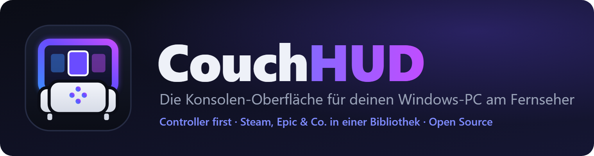
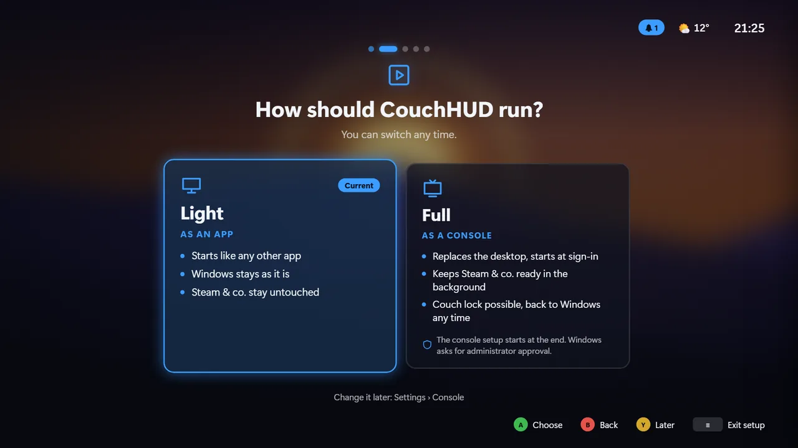

<p align="center"></p>

<p align="center">
  <b>Your Windows PC on the TV, run like a console.</b>
</p>

<p align="center">
  <a href="https://github.com/kewe87/CouchHUD/releases/latest"></a>
  <a href="https://github.com/kewe87/CouchHUD/actions/workflows/build.yml"></a>
  <a href="LICENSE"></a>
</p>

<p align="center"></p>

<sub>The games in the screenshots are made up, their covers drawn by the preview.</sub>

---

> **Version 0.4.1** – the first public release. Windows 10/11 x64, an XInput controller.
> Feedback from real living-room hardware is very welcome.

### What is CouchHUD?

An interface made only for the controller. Switch on, pick up the controller, play.

- **One library:** Steam, Epic, GOG, Ubisoft Connect, Xbox/Game Pass and your own entries, with artwork for non-Steam games too
- **Guide button over any game:** per-app volume, audio output, Bluetooth, notifications, power; hold it to get back
- **Instead of the desktop:** CouchHUD starts at sign-in, Steam & co. stay ready quietly in the background
- **Made for the couch:** browser as a tab, on-screen keyboard, phone as a remote, Wi-Fi, display, updates
- **5 skins** with their own sounds and mouse pointer, plus plugins and skins from the signed catalog
- **Couch lock and parental controls**, admin work in a background service: no UAC prompts day to day

Free, open (GPL-3.0), no account, no telemetry.

### Light or Full

The setup assistant asks on first start: Light or Full, skin, sound, game clients, couch lock.
Everything stays changeable in Settings.

| | **Light** (default) | **Full** |
|---|---|---|
| Starts | like any other app | instead of the desktop, at sign-in |
| Windows | stays as it is | shell replacement, auto sign-in, paused services |
| Steam & co. | untouched | kept ready in the background |
| Couch lock | – | controller code |
| Way back | – | *Settings › Console › Back to normal Windows* |

<p align="center"></p>

### Install

1. Download `CouchHud-Setup-0.4.1.exe` from [Releases](https://github.com/kewe87/CouchHUD/releases/latest) and run it.
2. Pick up the controller, the assistant does the rest.

**What the setup installs:**
- CouchHUD to `C:\Program Files\CouchHud` (fixed, no other folder)
- the Windows service **CouchHUD Service** (`CouchHud.Service`) for all admin tasks
- the WebView2 runtime if needed, a Start menu entry, optionally a desktop icon and autostart

**Requirements:** Windows 10 (1809 or later) or 11, x64, the WebView2 runtime (the setup brings it), an XInput controller
(Xbox pad, PlayStation pads via Steam Input or DS4Windows).

The setup has no Authenticode signature yet, so SmartScreen warns on first start. To check it is genuine:

<details>
<summary><b>Verify the download</b> (checksum, signature, provenance)</summary>

Put `CouchHud-Setup-0.4.1.exe`, `.sha256` and `.sha256.sig` from the same release into one folder, then in PowerShell 7:

```powershell
$f = 'CouchHud-Setup-0.4.1.exe'

# 1. Checksum: True
(Get-FileHash $f -Algorithm SHA256).Hash -eq (Get-Content "$f.sha256").Split(' ')[0]

# 2. Signature of the checksum file (ECDSA P-256): True
$pem = @'
-----BEGIN PUBLIC KEY-----
MFkwEwYHKoZIzj0CAQYIKoZIzj0DAQcDQgAEKAXgwgjwj5Rjl37hmf04Cj+/vP8S
JIKCCqRKrBy7MlNVIntuH2DjOkZMiobyQwlIZ3A20ypGgx77rtHg8vs88Q==
-----END PUBLIC KEY-----
'@
$key = [Security.Cryptography.ECDsa]::Create(); $key.ImportFromPem($pem)
$data = [Text.Encoding]::ASCII.GetBytes("couchhud-release-v1`n") + [IO.File]::ReadAllBytes("$PWD\$f.sha256")
$key.VerifyData([byte[]]$data, [Convert]::FromBase64String((Get-Content "$f.sha256.sig" -Raw).Trim()), 'SHA256')

# 3. Provenance: built by this repo's CI (GitHub CLI)
gh attestation verify $f --repo kewe87/CouchHUD --signer-workflow kewe87/CouchHUD/.github/workflows/build.yml
```

- The same key checks self-updates and the catalog. Fingerprint: [SECURITY.md](SECURITY.md).
- Build provenance only exists for releases built while the repo is public.

</details>

**Emergency:** hold **Ctrl + Shift** or **LB + RB + View** for about 1.5 seconds during start-up. Windows locks, and after
you sign in with the Windows password you get the normal desktop. More in the [guide](docs/GUIDE.md#emergency-exit).

### Controls

| Controller | Keyboard | Action |
|---|---|---|
| D-pad / left stick | Arrow keys | Navigate |
| A | Enter | Open / select |
| B | Esc | Back |
| X | X | Context action (search, sort, refresh) |
| Y | Y | Favorite, tile menu |
| LB / RB | Q / E | Switch tab |
| Start (≡) | M | Power menu |
| Guide | Home | Guide menu; **hold** to get back from any game |
| Back + Start | – | instead of the Guide button |

All buttons: [guide › Controls](docs/GUIDE.md#controls).

### Couch lock and parental controls

- **Couch lock:** leaving CouchHUD takes a controller code (6–8 buttons) or your Windows sign-in. While locked, only games start.
- **Parental controls:** daily play time, time windows, per-game limits, age rating; more time only with the parent code.
- If CouchHUD crashes or is closed, Windows locks.

### Security

- **Admin only in the service:** `CouchHud.Service` does admin tasks from a fixed list of operations. CouchHud.exe never runs with admin rights.
- **The service checks the codes**, with growing wait times after wrong tries. Parent and admin approvals use the Windows credential dialog on the secure desktop.
- **Fail-closed:** if the service is missing, the lock stays closed and Windows locks. *Repair service* sets it up again (one UAC prompt, Windows programs only).
- **Signed only:** self-update, catalog and CaseHUD install check an ECDSA signature.
- **Honest limits:** it protects against kids and guests at the controller, not against admins, foreign code in the same account, boot media or removed drives. A good Windows password and BitLocker or device encryption are recommended.

Details, limits and reporting a vulnerability: [SECURITY.md](SECURITY.md) · [disclaimer](docs/DISCLAIMER.md) · [privacy](docs/PRIVACY.md)

### Plugins, skins and catalog

- **Skins** are CSS plus optional glyphs, sounds and mouse pointer: [docs/SKINS.md](docs/SKINS.md)
- **Plugins** (C#) add game sources, pages, settings and Guide menu entries: [docs/PLUGINS.md](docs/PLUGINS.md)
- **Catalog** [`kewe87/CouchHUD-Catalog`](https://github.com/kewe87/CouchHUD-Catalog): install with A, signed index, mandatory checksums
- Included: the **Wand** plugin (cheats and mods), also the example for your own plugins

### CaseHUD

The sister project CaseHUD (`kewe87/CaseHUD`) shows temperatures and load on the LCDs in fans and pump heads.
CouchHUD can install it (signed releases from 1.0 only), start it and control it from the couch: displays,
designs, scenes and the **Lighting** page. More: [docs/CASEHUD.md](docs/CASEHUD.md)

### Build from source

.NET 10 SDK and Node.js. The commands are the same as in [Build from source](docs/GUIDE.md#build-from-source):
`dotnet build` / `dotnet test` on `CouchHud.slnx`, `node scripts/preview-server.js` runs the UI with mock data in any
browser, `bash scripts/check.sh` runs everything CI checks. CI builds the setup: [.github/workflows/build.yml](.github/workflows/build.yml).

### Contributing

- Issues and pull requests in English: [CONTRIBUTING.md](CONTRIBUTING.md)
- Report vulnerabilities privately only: [SECURITY.md](SECURITY.md)
- What's next: [docs/ROADMAP.md](docs/ROADMAP.md) · What changed: [CHANGELOG.md](CHANGELOG.md)
- Everything in detail: **[Guide](docs/GUIDE.md)**

---

## Third party

- Microsoft Edge WebView2 renders the interface (WebView2 SDK under Microsoft's license; the runtime comes from Windows or the Evergreen installer).
- System.ServiceProcess.ServiceController and System.Diagnostics.EventLog (MIT, .NET Foundation).
- QRCoder (MIT) draws the pairing QR code.
- Save game locations: the Ludusavi manifest, based on PCGamingWiki data (CC BY-NC-SA 3.0), downloaded at runtime, not shipped.
- Weather: Open-Meteo.com (CC BY 4.0). Artwork: the Steam store and, with your own key, SteamGridDB.
- The installer is built with Inno Setup (Inno Setup License).
- Logo, banner and screenshots are made for this project; the games shown are made up.

## License

Copyright © 2026 **kewe87**

Free software under the **GNU General Public License v3.0** ([LICENSE](LICENSE)). Forks and derivatives stay open
source under the same license and keep the copyright notice. Please use your own logo for forks.

## Disclaimer

No warranty (GPL-3.0, sections 15 and 16). If you ask it to, CouchHUD changes shell, sign-in, services and policies;
every change can be undone. **Use at your own risk.** Details: [docs/DISCLAIMER.md](docs/DISCLAIMER.md).

CouchHUD is not an official product of, and not affiliated with, Microsoft, Valve, Epic Games, Sony, GOG, Ubisoft,
Electronic Arts, Blizzard or any other company named here. Trademarks belong to their owners and are used only to
describe compatibility.
