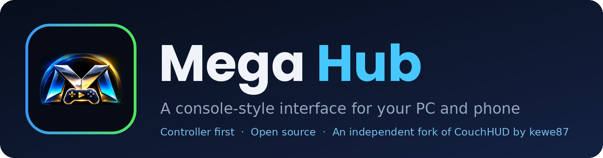

# Mega Hub



Logo generated with ChatGPT and supplied by jjrussellite28-art. [Source and provenance](ui/assets/MEGA-HUB-LOGO.md).

[](https://github.com/jjrussellite28-art/mega-hub/actions/workflows/build.yml)
[](https://github.com/jjrussellite28-art/mega-hub/actions/workflows/installer.yml)
[](LICENSE)

A controller-first Windows TV interface, independently maintained by **jjrussellite28-art**.

**Development preview — no Mega Hub release is published yet.**
This is an independent fork of [CouchHUD](https://github.com/kewe87/CouchHUD) by **kewe87 and contributors**,
under the GNU GPL v3. It is not an official CouchHUD product and is not endorsed or supported by that project.

## What it does

The inherited application brings game launchers and a game library into a controller-driven TV interface.
It includes an optional Windows shell mode, a background service, parental controls, and plugin support.
See the [English guide](docs/GUIDE.en.md) for inherited functionality. Older guide pages and screenshots
still use CouchHUD terminology; they are being reviewed for this fork.

## What is new in Mega Hub

Mega Hub keeps everything the inherited application does and adds its own work on top:

- **PC mode quits Mega Hub completely**, so it no longer uses memory while you use Windows normally.
- **Unlock button** on the tab bar: the Windows PIN or password plus the Mega Hub code unlock the whole PC until the lid is closed for a few minutes, the PC powers down or restarts.
- **Close my programs when returning** to the couch, with a choice of which programs, and **startup programs off by default**.
- **Update Mega Hub** (Settings › Power) fetches the newest version from this repository, shows its progress inside the app and also updates your own plugins.
- **Developer mode** (Settings › Power) for testing your own unsigned plugins.
- Own **Achievements** plugin, a Mega Hub logo and rebranded text.

Credit stays with the original project: the base application is [CouchHUD](https://github.com/kewe87/CouchHUD) by kewe87 and contributors.

## Changes in this fork

This preparation introduces the Mega Hub identity, preserves upstream attribution,
points app updates and project links at this repository, packages licensing/source information,
and prevents automatic release publication. See [FORK-CHANGES.md](FORK-CHANGES.md).
These changes do not claim authorship of the inherited application or new game-launcher features.

## Downloads and support

Development builds of the installer (`MegaHub-Setup-*.exe`) are published on
[this repository's releases page](https://github.com/jjrussellite28-art/mega-hub/releases) under **Latest installer**.
Installers from the original CouchHUD project are not builds of this fork.
For development feedback, use [pull requests](https://github.com/jjrussellite28-art/mega-hub/pulls).
Issues are currently disabled. Do not send support requests for this fork to the CouchHUD maintainer.
Do not post passwords, API keys, personal configuration or exploit details publicly.

## Build a development version

Windows 10 (1809+) or Windows 11 x64, .NET 10 SDK, Node.js 22.13+ and an XInput-compatible controller.

```powershell
dotnet restore MegaHub.slnx
dotnet build MegaHub.slnx -c Release
dotnet test MegaHub.slnx -c Release --no-build
dotnet run --project src/MegaHub.Shell -- --dev
```

Browser preview with mock data: `node scripts/preview-server.js`.
Installer build instructions are in `.github/workflows/build.yml` (Inno Setup 6).
A few internal names are kept from CouchHUD for compatibility (for example the `couchhud-*-v1` signature labels and the `CouchHud.Sdk` plugin SDK).
Do not install this development fork next to CouchHUD until installer isolation has been verified (see the release checklist).
Use a disposable Windows test environment for installer and shell-mode testing.

## License, source and commercial distribution

The code remains **GPL-3.0-only**. Read [LICENSE](LICENSE), [CREDITS.md](CREDITS.md),
and [THIRD-PARTY-NOTICES.md](THIRD-PARTY-NOTICES.md).
You may charge for GPL-covered copies and support, while preserving recipients' GPL rights.
Distributions must retain notices and provide the exact corresponding source and required build/install materials.
Third-party assets, data and services require their own review; GPL does not override their terms.
See [SOURCE.md](SOURCE.md) and the [release checklist](docs/RELEASE-CHECKLIST.md).

## Before public distribution

Remaining installer artwork, installer isolation, fork-owned release signing, third-party commercial-use review,
and Windows installer/shell recovery testing remain open. A README update is not certification of release readiness.
No release should be published until the checklist is complete.

## Windows or browser says the download is unsafe

When you download or run the installer, Windows (SmartScreen) or your browser may say something like
*"MegaHub-Setup isn't commonly downloaded"*, *"Windows protected your PC"* or *"unknown publisher"*.

This is **expected for a new, independent program** and does not mean the file is a virus. These warnings appear for any
installer that is new, has few downloads, or is not signed with a paid code-signing certificate from a commercial company.
Mega Hub is free, open source (GPL v3) and not signed that way yet, so Windows cannot recognise it. The whole source code is in this
repository, and the installer is built here by GitHub Actions from that source.

To continue anyway: in the browser choose the **⋯** menu next to the download and then **Keep**; in Windows choose
**More info** and then **Run anyway**. Only do this for files you downloaded from this repository's releases page.
Paid code signing may be added in the future, which would reduce these warnings.
