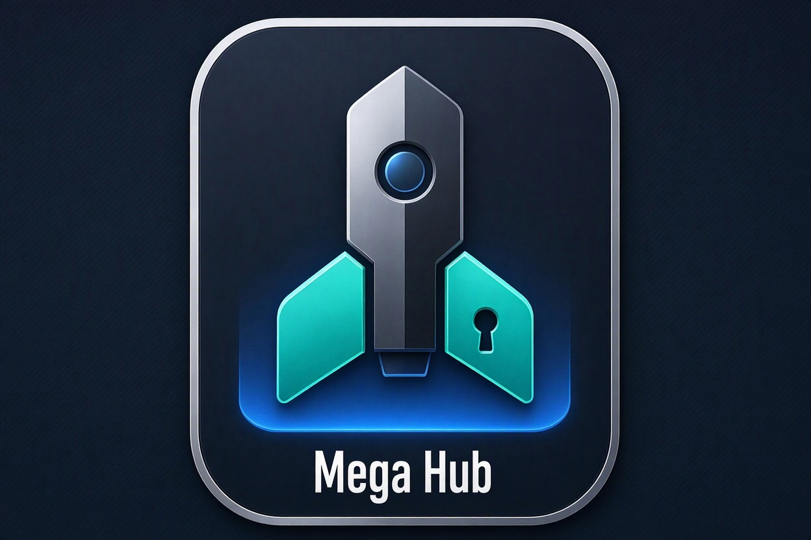

# Mega Hub



Logo generated with Bing Image Creator and supplied by jjrussellite28-art. [Source and provenance](ui/assets/MEGA-HUB-LOGO.md).

[](https://github.com/jjrussellite28-art/mega-hub/actions/workflows/build.yml)
[](https://github.com/jjrussellite28-art/mega-hub/actions/workflows/installer.yml)
[](LICENSE)

A controller-first Windows TV interface, independently maintained by **jjrussellite28-art**.

**Development preview — no Mega Hub release is published yet.**
This is a fork of [Mega Hub](https://github.com/kewe87/CouchHUD) by **kewe87 and contributors**,
under the GNU GPL v3. It is not an official Mega Hub product and is not endorsed or supported by that project.

## What it does

The inherited application brings game launchers and a game library into a controller-driven TV interface.
It includes an optional Windows shell mode, a background service, parental controls, and plugin support.
See the [English guide](docs/GUIDE.en.md) for inherited functionality. Older guide pages and screenshots
still use Mega Hub terminology; they are being reviewed for this fork.

## What is new in Mega Hub

Mega Hub keeps everything the inherited application does and adds its own work on top:

- **PC mode quits Mega Hub completely**, so it no longer uses memory while you use Windows normally.
- **Unlock button** on the tab bar: the Windows PIN or password plus the Mega Hub code unlock the whole PC until the lid is closed for a few minutes, the PC powers down or restarts.
- **Close my programs when returning** to the couch, with a choice of which programs, and **startup programs off by default**.
- **Update Mega Hub** (Settings › Power) fetches the newest version from this repository, shows its progress inside the app and also updates your own plugins.
- **Developer mode** (Settings › Power) for testing your own unsigned plugins.
- Own **Achievements** plugin, a Mega Hub logo and rebranded text.

Credit stays with the original project: the base application is Mega Hub by kewe87 and contributors.

## Changes in this fork

This preparation introduces the Mega Hub identity, preserves upstream attribution,
points app updates and project links at this repository, packages licensing/source information,
and prevents automatic release publication. See [FORK-CHANGES.md](FORK-CHANGES.md).
These changes do not claim authorship of the inherited application or new game-launcher features.

## Downloads and support

There is currently **no approved Mega Hub installer**. Do not treat upstream Mega Hub installers
as builds of this fork. Future reviewed builds will appear only on
[this repository's releases page](https://github.com/jjrussellite28-art/mega-hub/releases).
For development feedback, use [pull requests](https://github.com/jjrussellite28-art/mega-hub/pulls).
Issues are currently disabled. Do not send fork support requests to Mega Hub's maintainer.
Do not post passwords, API keys, personal configuration or exploit details publicly.

## Build a development version

Windows 10 (1809+) or Windows 11 x64, .NET 10 SDK, Node.js 22.13+ and an XInput-compatible controller.

```powershell
dotnet restore MegaHub.slnx
dotnet build MegaHub.slnx -c Release
dotnet test MegaHub.slnx -c Release --no-build
dotnet run --project src/MegaHub.Shell -- --dev
```

Browser preview with mock data: `node scripts/preview-server.js`.
Installer build instructions are in `.github/workflows/build.yml` (Inno Setup 6).
Internal `Mega Hub` assembly, service, data and protocol names are inherited compatibility identifiers.
**Do not install this development fork alongside or over Mega Hub**: those identifiers are not isolated yet.
Use a disposable Windows test environment for installer and shell-mode testing.

## License, source and commercial distribution

The code remains **GPL-3.0-only**. Read [LICENSE](LICENSE), [CREDITS.md](CREDITS.md),
and [THIRD-PARTY-NOTICES.md](THIRD-PARTY-NOTICES.md).
You may charge for GPL-covered copies and support, while preserving recipients' GPL rights.
Distributions must retain notices and provide the exact corresponding source and required build/install materials.
Third-party assets, data and services require their own review; GPL does not override their terms.
See [SOURCE.md](SOURCE.md) and the [release checklist](docs/RELEASE-CHECKLIST.md).

## Before public distribution

Remaining installer artwork, installer isolation, fork-owned release signing, third-party commercial-use review,
and Windows installer/shell recovery testing remain open. A README update is not certification of release readiness.
No release should be published until the checklist is complete.
