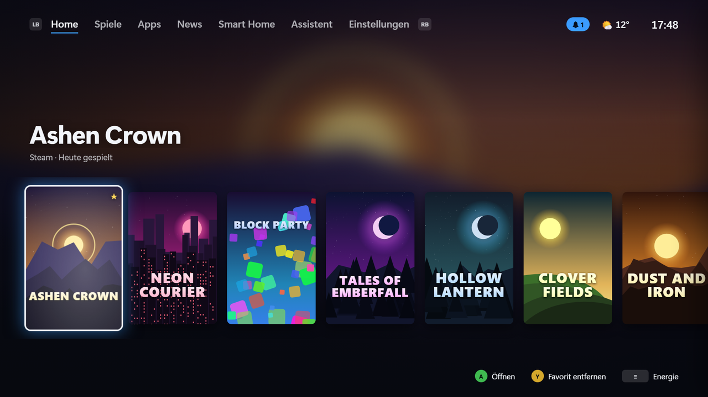
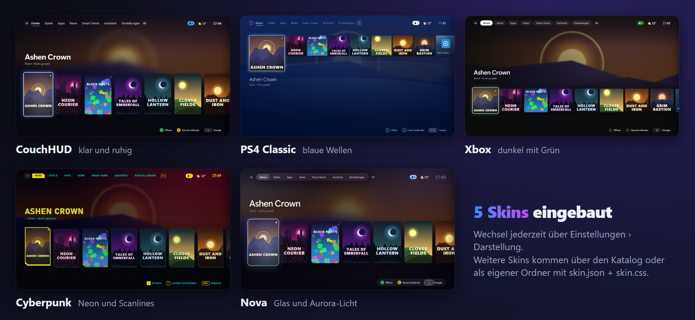

# Mega Hub – Handbuch

**Deutsch** | [English](GUIDE.en.md)

Das vollständige Handbuch: alle Funktionen, Einstellungen, Steuerung, Konfiguration und Architektur. Kurzüberblick und Screenshots: [README](../README.md).

Controller-first Fullscreen-Oberfläche für den Wohnzimmer-PC am TV. Ersetzt auf Wunsch die komplette Windows-Shell (`explorer.exe`): Nach dem Login landest du direkt in Mega Hub, bedienst alles mit dem Controller und verlässt es nur, wenn du bewusst in den **PC-Modus** wechselst.

Unabhängig von Steam Big Picture, Playnite & Co. Steam-, Epic-, GOG-, Ubisoft- und Xbox-Spiele werden aber automatisch erkannt.



## Features

**Oberfläche**
- **Deutsch und Englisch**: Die Sprache folgt standardmäßig der Windows-Anzeigesprache und lässt sich unter *Einstellungen › Info › Sprache* sofort umstellen (Oberfläche, Meldungen, Tray-Menü und Setup). Texte und Begriffe: [i18n.md](i18n.md).
- **Konsolen-UI** mit den Tabs Home, Spiele, Apps, News, Assistent und Einstellungen. Plugins können eigene Tabs bringen (etwa Smart Home mit dem Plugin Home Assistant); der Assistent erscheint, sobald ein KI-Anbieter eingerichtet ist. Skaliert von 1080p bis 4K.
- **Home-Shelf** mit Clear Logos, großem Hero-Artwork und Hintergrund-Trailern: Bleibt der Fokus kurz auf einem Spiel, läuft der Steam-Trailer stumm im Hintergrund an (abschaltbar).
- **Farben aus dem Artwork**: Der Hintergrund leuchtet in der Farbe des fokussierten Covers.
- **Tiefe und Bewegung**: Parallax, leichtes Kippen mit Lichtreflex auf der fokussierten Kachel, Boot-Screen, Seitenübergänge und ein Übergang beim Spielstart („Spiel startet …“ mit Artwork). *Einstellungen › Darstellung › Animationen reduzieren* nimmt Tiefeneffekt, Kippen und Lichtreflex heraus.
- **Skins**: Der Mega-Hub-Skin ist im Programm, Tiefsee, Grünlicht, Neonstadt, Nova, Sternenstaub und weitere kommen aus dem Katalog (*Einstellungen › Plugins & Skins*), mit Live-Vorschau. Wer einen der früher eingebauten Skins benutzt hat, bekommt ihn beim ersten Start nach dem Update von Mega Hub aus dem Katalog installiert. Eigene Skins sind möglich (siehe [Skins](#skins)).
- **HDR-Modus** (Aus, Automatisch, An): Artwork und Trailer in voller HDR-Helligkeit, Wide-Gamut-Farben pro Skin (echtes Neon bei Neonstadt), Lichtreflex über der fokussierten Kachel, Boot-Blitz. „An“ schaltet Windows-HDR ein, solange Mega Hub läuft.
- **UI-Sounds pro Skin** (live synthetisiert; eigene Skins können eigene Sounddateien mitbringen) und optional dezente **Hintergrundmusik** pro Skin, mit eigenen Lautstärkereglern. Alles verstummt, sobald ein Spiel oder eine andere Vollbild-App vorne ist.
- Controller-Vibration (abschaltbar).
- **Bildschirmschoner** gegen OLED-Einbrennen: Artwork-Diashow, wandernde Uhr, Abdunkeln oder Schwarz, dazu Pixel-Shift und auf Wunsch Fernseher aus. Controller-Eingaben zählen auch für Windows als Aktivität.

**Bibliothek**
- Steam (alle Library-Folders), Epic, GOG (mit und ohne Galaxy), Ubisoft Connect und Xbox/Game Pass werden automatisch erkannt, dazu eigene Einträge. EA app und Battle.net starten zwar als Spiele-Clients mit, ihre Spiele erscheinen aber nur über überwachte Spieleordner oder eigene Einträge.
- **Spieleordner überwachen**: Alles in z.B. `D:\Games` landet automatisch in der Bibliothek, auch später installierte Spiele. Eine Suche findet typische Spieleordner auf allen Laufwerken.
- **Welche Datei ist das Spiel?** In einem Spieleordner nimmt Mega Hub die Programmdatei, die am besten zum Ordnernamen passt, und lässt Installer, Deinstaller, Absturzmelder, Prüfsummen-Werkzeuge (z.B. RapidCRC), Anti-Cheat und Redistributables aus. Bei Unreal-Spielen (`Spiel.exe` neben `Spiel-Win64-Shipping.exe`) startet die kleine Datei oben im Ordner, der Name kommt vom Ordner. Der Name stammt aus dem Produktnamen der Datei, wenn er zum Ordner passt, sonst aus dem bereinigten Ordnernamen (Versionsnummern, „Repack“, „+ 3 DLCs“, Konsolen-Kennungen fallen weg). Ein Steam- oder Launcher-Ordner im Spieleordner wird nicht als Spiel aufgenommen. Wählt Mega Hub nach einem Update eine andere Datei als vorher, bleiben Favoriten, Sperren, Spielzeiten und deine Änderungen beim Spiel; ein überwachter Ordner unter `steamapps` wird nicht als Spielesammlung gelesen.
- **Hinzufügen**: Auf den Seiten Spiele und Apps ist die letzte Kachel **+ Hinzufügen** (auch im Filter-Menü, X). Auf der Apps-Seite bietet Mega Hub zuerst die **Liste der installierten Programme** wie im Startmenü, auch Store-Apps wie Claude (LB/RB springen von Buchstabe zu Buchstabe, X sucht; „Andere …“ am Ende wählt eine Datei). Schon vorhandene Einträge sind markiert. Store-Apps starten über Windows selbst (`shell:AppsFolder`); da kein Programmordner bekannt ist, zeigt Mega Hub sie nicht als „läuft“ an. Hinzufügen braucht bei gesperrter Couch den Code.
- **Startparameter und Arbeitsordner** (Expertenmodus, nur eigene Einträge mit EXE): im Bearbeiten-Dialog des Eintrags. Die Parameter gehen einzeln an das Programm, ohne Shell; der Arbeitsordner muss existieren. Der Assistent und MCP können sie nicht ändern (nur beim Anlegen über `add_entry`, mit Bestätigung auf dem TV). Beispiel „Claude Code“: Programm `C:\Users\<Name>\.local\bin\claude.exe`, Startparameter `--continue`, Arbeitsordner `D:\megahub` (oder `wt.exe` mit `-d D:\megahub claude --continue` für Windows Terminal). Terminals, Shells und Interpreter (`claude`, `python`, `node`, `bash` …) sind nie Spiele, nur Apps; auf einer gesperrten Couch brauchen sie den Code.
- **Batch-Datei als Startziel** (`.bat`/`.cmd`, Expertenmodus): läuft ohne sichtbares Konsolenfenster. Das Skript sollte deshalb nichts abfragen: Wartet es mit `pause`, `set /p` oder `choice` auf eine Eingabe und läuft etwa 15 s lang nichts darunter (kein Spiel, kein `timeout`), beendet Mega Hub genau diese cmd.exe (frühestens nach 30 s, nach dem Ende des Spiels auch früher) und sagt das in einem Hinweis; ebenso beim Beenden von Mega Hub. Ein Spiel, das das Skript im Vordergrund startet, hält es am Leben, auch Warteschleifen mit `timeout` oder `tasklist`. `timeout /t 5` funktioniert. Die Datei muss im Ordner des Spiels liegen; liegt das Spiel selbst in einem Programmordner wie `_retail_`, `bin` oder `Binaries\Win64`, darf sie auch im Hauptordner darüber liegen (z. B. `Call of Duty\start.cmd`), aber nie in einem Ordner mit mehreren Spielen (beobachteter Spielordner, `steamapps\common`).
- **Ordner scannen**: Mega Hub schlägt die passenden EXEs vor und ignoriert Installer, Crash-Reporter und Redistributables. Einträge kannst du umbenennen, ausblenden oder als Spiel bzw. App einordnen.
- **Ausblenden**: Y auf einem Eintrag öffnet sein Menü, in Spiele, Apps, Sammlungen und auf Home gleich; *Ausblenden* fragt kurz nach und nimmt den Eintrag aus allen Listen, auch Fehlgriffe beim Ordner-Scan. Er bleibt ausgeblendet, auch nach neuem Suchen und wenn der Scan im selben Spieleordner später eine andere EXE wählt (Mega Hub merkt sich Store-Kennung bzw. EXE und Spieleordner, nicht nur den Eintrag). Zurückholen: *Einstellungen › Bibliothek › Ausgeblendete Einträge*, A zeigt ihn wieder an; Einträge, die es nicht mehr gibt (deinstalliert, Ordner entfernt), stehen dort nur mit Namen und lassen sich mit A von der Liste entfernen. Ausblenden und wieder anzeigen brauchen bei gesperrter Couch den Code, mit Jugendschutz den Eltern-Code. Ausgeblendete Spiele zählen für den Jugendschutz weiter (Spielzeit, Limits, gesperrte Einträge): Ausblenden umgeht keine Regel. Ausblenden räumt nur die Listen auf; zum Sperren eines Spiels die Spielsperre oder Altersregeln nutzen.
- **Suchen, sortieren, filtern** (X in Spiele und Apps): per Bildschirmtastatur oder Handy, nach Name, zuletzt benutzt, Spielzeit oder Store, nur Favoriten.
- **Artwork** von SteamGridDB (Cover, Hero, Clear Logo, Quadrat; mit eigenem Key) und aus dem Steam-Store, auch für Nicht-Steam-Spiele. Zuerst kommen lokale Quellen (Steams `librarycache`, der Katalog-Cache des Epic Launchers, Paket-Logos von Xbox-Spielen, Ubisoft-Cache, Symbole der Programmdateien), erst dann Steam-CDN und SteamGridDB; fehlt alles, zeichnet Mega Hub selbst ein Banner. **Jedes Bild wird nur einmal geladen und liegt danach im lokalen Artwork-Cache** (`%LOCALAPPDATA%\MegaHub\artwork`, höchstens ca. 750 MB, Bilder aktueller Einträge bleiben erhalten). Die Oberfläche lädt Artwork nie selbst aus dem Internet. Online-Artwork lässt sich unter Einstellungen › Datenschutz abschalten; den Cache leert der Expertenmodus in der Bibliothek.
- **Artwork ändern**: Auf der Detailseite zeigt „Artwork ändern“ alle Treffer von SteamGridDB (mit Key) und dem Steam-CDN für Cover, Banner und Logo. Mit dem Controller wählen, A übernimmt, „Automatisch“ setzt zurück, „Eigenes Bild“ nimmt eine Datei vom PC. Die Wahl gilt pro Eintrag und bleibt nach jedem Scan erhalten.
- **Artwork suchen** (Bearbeiten-Menü eines Eintrags, nicht bei Steam-Spielen): Zeigt das Spiel ein falsches Bild, weil Mega Hub ein anderes Spiel erkannt hat, listet „Artwork suchen“ die Treffer aus dem Steam-Store und von SteamGridDB (mit Key) für einen Suchbegriff, den du ändern kannst, mit Jahr, Plattform und Vorschaubild. A legt das Spiel fest; die Festlegung gilt pro Eintrag, bleibt nach jedem Scan und nach „Artwork neu laden“ erhalten und kann mit „Wieder automatisch“ aufgehoben werden. Online gewählte Bilder des falschen Spiels fallen dabei weg, eigene Bilder bleiben. Automatisch nimmt Mega Hub nur noch Treffer, die sicher zum Namen passen (gleicher Name, Zahlen und römische Ziffern zählen); sonst bleibt die Kachel leer und die Detailseite bietet „Artwork wählen“ an. Bei abgeschaltetem Online-Artwork (Einstellungen › Datenschutz) sucht Mega Hub nicht. Mit gesperrter Couch muss erst entsperrt werden.
- **Sammlungen**: Eigene Listen wie „Couch-Koop“ oder „Kinder“. Y auf einer Kachel in Spiele, Apps und auf Home öffnet das Menü mit „Sammlungen …“ (auf der Detailseite gibt es die Aktion „Sammlungen“; Y bleibt dort Favorit). X in Spiele und Apps zeigt eine Sammlung als Filter an und verwaltet sie (anlegen, umbenennen, löschen, Name per Bildschirmtastatur). „An Home anheften“ legt eine Kachel in die Reihe auf Home.
- **Detailseite** pro Spiel: Beschreibung, Screenshots, Entwickler, Genres (aus dem Steam-Store, in der Sprache der Oberfläche), Spielzeit, zuletzt gespielt, Installationsort, Größe, Deinstallieren.
- **Laufendes Spiel und Spielzeit**: Mega Hub erkennt das laufende Spiel (Steam-AppID bzw. Prozesse im Installationsordner) und zählt die Spielzeit pro Spiel.
- **Spielstände sichern**: Speicherorte, Größe und letzte Änderung aus der Community-Datenbank [Ludusavi-Manifest](https://github.com/mtkennerly/ludusavi-manifest) (PCGamingWiki, Zuordnung per Steam-ID oder Name). Auf der Detailseite *Spielstände* › *Jetzt sichern* (ZIP mit Datum unter `%APPDATA%\MegaHub\Backups\<Spiel>`, Ordner und Anzahl in den Einstellungen) und *Wiederherstellen* (vorher wird der aktuelle Stand automatisch gesichert). Vor dem Deinstallieren wird ein Backup angeboten. Sicherungen mit Fehlern werden als unvollständig markiert und nie automatisch gelöscht, Sicherheits-Backups vor einer Wiederherstellung rotieren getrennt (letzte 3), und scheitert das Zurückschreiben, wird der alte Stand automatisch zurückgespielt. Während das Spiel läuft (auch wenn es außerhalb von Mega Hub gestartet wurde), ist beides gesperrt. Registry-Spielstände werden angezeigt, aber noch nicht gesichert. Die Datenbank (~18 MB) wird höchstens einmal pro Woche von GitHub geladen.
- **Automatische Sicherung nach dem Spielen**: Endet ein Spiel (auch eines, das außerhalb von Mega Hub gestartet wurde), sichert Mega Hub nach 20 Sekunden die bekannten Spielstand-Ordner im Hintergrund mit niedriger Priorität (*Einstellungen › Bibliothek › Spielstände nach dem Spielen sichern*, Standard an). Unveränderte Stände werden nicht noch einmal gesichert, gemeldet wird nur bei Fehlern oder erreichten Grenzen. Im Expertenmodus stellst du die Grenzen ein: automatische Sicherungen pro Spiel (3, getrennt von den eigenen), Größe pro Spiel (1 GB) und Platz für alle Sicherungen (10 GB); größere Ordner werden übersprungen, die Grenze pro Spiel gilt auch für Sicherungen von Hand. In der Auswahl stehen sie als „automatisch nach dem Spielen“. OneDrive-Ordner werden normal gesichert; liegen Dateien nur online, wartet die automatische Sicherung, bis sie wieder lokal sind, damit nichts heruntergeladen wird (ein leiser Hinweis höchstens einmal am Tag). Eine Sicherung von Hand legt keine neue Version an, wenn die Dateien genau denen der letzten Sicherung von Hand entsprechen, und meldet „unverändert“, auch vor dem Deinstallieren (die passende Sicherung ist dann schon da). Wiederherstellen und Löschen brauchen eine offene Couch-Sperre, mit Jugendschutz den Eltern-Code; ebenso die Einstellungen der Sicherung. Vor dem Wiederherstellen wird der aktuelle Stand gesichert. Der Sicherungsordner darf nicht in den Spielstand-Orten liegen (Saved Games, Dokumente\My Games, AppData\LocalLow, Steam). Hast du dein Profil oder `C:\Users` per Junction auf ein anderes Laufwerk verschoben, lehnt Mega Hub den Standardordner ab; wähle dann im Expertenmodus einen Ordner auf dem echten Pfad.
- **Weiterspielen**: Home beginnt mit den zuletzt gespielten Spielen (bis zu 6, das laufende zuerst, die erste Karte groß), jeweils mit „zuletzt gespielt“, Gesamtspielzeit und letzter Sitzung. Gesperrte Spiele erscheinen wie in der Bibliothek. Fortschritt (Erfolge) zeigt Mega Hub nicht, weil es dafür keine verlässliche lokale Quelle gibt.
- **Ein Spiel zur Zeit, wie auf der Konsole**: Startest du das laufende Spiel noch einmal, kommt es einfach wieder nach vorne. Startest du ein anderes Spiel, fragt Mega Hub „<Spiel> wird beendet“ (Abbrechen ist vorausgewählt). Mit *Neues Spiel starten* wird das laufende Spiel zuerst gebeten, sich zu schließen (wie das X am Fenster, damit es speichern kann), nach 10 Sekunden notfalls beendet, dann startet das neue. Beendet werden nur die Prozesse, die Mega Hub für dieses Spiel gesehen hat (geprüft an Prozessnummer, Startzeit und Programmdatei), und was sie gestartet haben; Spiele-Clients wie Steam, Windows und Mega Hub selbst nie. Lässt sich das alte Spiel nicht beenden, startet das neue nicht. Apps und Webseiten starten weiter neben dem Spiel (mit Jugendschutz nicht). „Zurück zum Spiel“ holt das Spielfenster auch dann nach vorne, wenn es minimiert ist; Automatiken (Spiele-Clients, die beim Start mitlaufen, der Vordergrund-Wächter) holen Mega Hub nie über ein laufendes oder startendes Spiel, das macht nur die Guide-Taste.

**Bedienung**
- **Guide-Taste wie auf der Konsole**: Der Guide-Button wird global per XInput abgefragt und funktioniert auch, während ein Spiel läuft. Im Spiel antippen holt Mega Hub nach vorne, das laufende Spiel steht als erste Kachel auf Home und läuft weiter. *Einstellungen › Controller › Spiel pausieren, solange Mega Hub vorne ist* (Expertenmodus, aus) friert es stattdessen ein. **Achtung Anti-Cheat:** Ein eingefrorenes Spiel kann für ein Anti-Cheat-System wie Manipulation aussehen und das Konto sperren lassen. Mega Hub friert deshalb kein Spiel mit erkanntem Anti-Cheat ein (Easy Anti-Cheat, BattlEye, Vanguard, nProtect GameGuard, XIGNCODE, PunkBuster, Ricochet, mhyprot, ACE, EQU8, FACEIT und ähnliche), erkannt an Dateien und Ordnern im Installationsordner des Spiels und an seinen laufenden Prozessen, ohne Netz. Lässt sich das nicht prüfen (Ordner fehlt, ist ein Link, zu groß, nicht lesbar), friert Mega Hub ebenfalls nicht ein. Einmal pro Spielsitzung sagt eine Meldung, warum. Ein Anti-Cheat, das Mega Hub nicht kennt, erkennt es nicht: Online-Spiele besser nicht einfrieren. Halten bringt dich aus einem Spiel oder dem PC-Modus immer zurück. Was ein Antippen tut, stellst du unter *Einstellungen › Controller › Guide-Taste im Spiel* ein (*Mega Hub öffnen*, *Game Bar öffnen*, *Nur Guide halten*). Zwei Controller-Slots, die sich spiegeln (virtuelle Pads von Steam Input oder DS4Windows), zählen nur einmal.
- **PlayStation-Controller** (DualShock 4, DualSense, DualSense Edge) direkt per USB oder Bluetooth, ohne Steam oder DS4Windows: Kreuz = A, Kreis = B, Quadrat = X, Dreieck = Y, Options = Start, Create/Share und Touchpad-Klick = Ansicht, PS = Guide (auch im Spiel, PS + Dreieck für den Screenshot). Mega Hub liest das Pad nur (geteilt, Spiele und Steam sehen es weiter), schreibt nichts hin (keine Vibration, keine Lichtleiste) und wertet Gyro und Touchpad nicht aus. Den Akkustand meldet das Pad über USB immer, über Bluetooth nur im vollen Modus (etwa nachdem Steam oder ein Spiel es umgeschaltet hat). Spiegelt Steam Input oder DS4Windows das Pad als Xbox-Pad, zählt jeder Druck einmal. Pads anderer Hersteller mit PlayStation-Lizenz laufen weiter über Steam Input oder DS4Windows; versteckt DS4Windows das Original (exklusiver Modus, HidHide), sieht Mega Hub nur das Xbox-Pad.
- **Tastensymbole wie am Controller**: Hinweisleisten, Menüs, Dialoge und die Code-Abfrage zeigen die Symbole des zuletzt benutzten Controllers (✕ ○ □ △, L1/R1, OPTIONS, PS oder A B X Y, LB/RB, ≡, Guide; andere Pads zählen als Xbox). Handy und Tastatur ändern sie nicht. Festlegen unter *Einstellungen › Controller › Tastensymbole* (Expertenmodus: *Automatisch*, *Xbox*, *PlayStation*), etwa wenn DS4Windows das Pad versteckt.
- **Guide-Menü**: Zurück zum Spiel, Spiel beenden (bei Hängern erzwingen), Lautstärke, Lautstärke pro App, Audio-Ausgang, CPU/GPU/RAM-Auslastung, Wetter, Akkustand (Controller in vier Stufen, Bluetooth-Geräte in Prozent, Laptop), Benachrichtigungen, Bluetooth, Aufnahmen, laufende Programme, Plugin-Aktionen, Ausschalt-Timer, Energie.
- **Browser** für den Fernseher: Websites mit dem Controller, Stick als Mauszeiger, großer Zoom, Lesezeichen, Adresse per Bildschirmtastatur oder Handy. Eigenes Profil ohne Zugriff auf Mega Hub. Der Browser ist ein Teil des Mega-Hub-Fensters (kein eigenes Fenster) mit schlanker Leiste oben: Zurück, Vor, Neu laden, Adresse (antippen öffnet die Bildschirmtastatur), Zoom, Startseite, Schließen. Die Leiste blendet sich nach einigen Sekunden aus, die Ansicht-Taste holt sie zurück; B geht im Verlauf zurück und schließt am Anfang, LB/RB zoomen, Guide führt zu Mega Hub, Videos laufen im Vollbild. **Alle Links in Mega Hub öffnen hier** (Nachrichten, Plugins, Website-Einträge), nie im Standardbrowser von Windows; es gelten die Regeln der Couch-Sperre (mit Sperre fragt Mega Hub nach dem Code), und nur http und https werden geöffnet. Nach dem Schließen bist du wieder dort, wo du herkamst (z.B. im Artikel). **Ausnahme Streaming mit Kopierschutz:** Netflix, Disney+, Prime Video & Co. spielen im eingebauten Browser nicht (WebView2 bringt kein Widevine mit); für diese Website-Einträge steht „Im Streaming-Browser öffnen (für Filme und Serien mit Kopierschutz)“ (Bearbeiten-Menü des Eintrags), bei bekannten Diensten ist es von Anfang an gesetzt. Nur dafür gilt die Einstellung „Streaming-Browser im Vollbild öffnen“. Bekannt: Google-Anmeldungen sind in eingebetteten Browsern von Google gesperrt.
- **Bildschirmtastatur** (QWERTZ) und **Datei-Browser** per Controller.
- **Maus**: Bei Bewegung erscheint eine große Comic-Maus als Zeiger (mit wackelndem Schwanz), die nach kurzer Zeit wieder verschwindet. Der Controller-Fokus bleibt führend. Für Logins und Dialoge kann der Controller selbst zur Maus werden.
- **Handy als Tastatur und Fernbedienung**: QR-Code am TV scannen, dann am Handy tippen, diktieren oder einfügen und mit Steuerkreuz und Tasten bedienen. Die Verbindung im WLAN ist (bei vor 0.7 gekoppelten Handys) unverschlüsselt, und auch verschlüsselt bleibt sie ohne HTTPS; deshalb tippt das Handy nie in Passwort- und Key-Felder: Mega Hubs eigene Bildschirmtastatur lehnt es bei geheimen Feldern ab, und vor jedem Tippen in ein fremdes Fenster (Launcher-Login) prüft Mega Hub das Feld mit Windows (Passwortfeld oder Feldname wie „Passwort“, „PIN“, „Key“) und weist es ab. Solche Eingaben gehören an den TV. Ehrlich dazu: Windows kann nicht in jedes Feld hineinsehen. Wo das Feld unbekannt bleibt und das Fenster zu einem Launcher oder Browser gehört (Steam, Epic, Chrome, Edge, auch Mega Hubs eigener Browser), tippt das Handy deshalb gar nicht, sondern bittet um die Eingabe am TV; bei Spielen und anderen Programmen ohne Auskunft bleibt Tippen erlaubt. Geprüft wird kurz vor dem Tippen, jeweils nur ein Prüfvorgang gleichzeitig, und nur wenn dasselbe Fenster noch vorn ist. Die Verbindung nimmt nur Geräte aus dem eigenen Netz an (private und Link-Local-Adressen, nie aus dem Internet; Adressen aus 100.64.0.0/10, also Tailscale und andere CGNAT-Netze, lehnt Mega Hub bewusst ab); gekoppelte Handys laufen nach 180 Tagen ohne Benutzung ab und lassen sich einzeln entkoppeln. Die Firewall-Freigabe gilt nur für den benutzten Port und das lokale Subnetz und verschwindet, wenn Handy-Verbindung und MCP im Netzwerk aus sind. Mit Jugendschutz schalten nur die Eltern die Handy-Verbindung (wie MCP und MCP im Heimnetz) ein: erst die Couch entsperren, dann der Eltern-Code für genau diesen Schalter; Ausschalten geht ohne.
- **Energie vom Handy** (ab 0.7.0): Unter den Tasten hat die Handy-Seite den Bereich *Energie* mit Standby, Neu starten und Herunterfahren, etwa um den PC auszuschalten, wenn der Fernseher schon aus ist. Jeder Knopf fragt erst auf dem Handy nach („PC herunterfahren?“); der Bestätigen-Knopf liegt an anderer Stelle und lässt sich erst nach einer Sekunde drücken, ein versehentlicher Tipp oder Doppeltipp schaltet also nie etwas aus. Läuft am TV ein Spiel, steht das in der Frage („Ein Spiel läuft: …“). Es gelten dieselben Regeln wie im Energie-Menü am TV: Was dort einen Code bräuchte, lehnt das Handy ab („Das geht nur am TV mit dem Code“), statt einen Code übers WLAN zu schicken. Im Desktop-Modus (PC-Modus) geht das nicht, dann arbeitet ja jemand am PC. Wer das nicht will, schaltet es unter *Einstellungen › Handy › Handy darf den PC ausschalten / neu starten* aus (Standard: an); dann verschwindet der Bereich auf dem Handy. Der TV zeigt kurz, welches Handy was ausgelöst hat. Den Abschalt-Timer gibt es weiter nur am TV.
- **Bibliothek vom Handy** (ab 0.7): Ab 0.7 gekoppelte Handys sind verschlüsselt verbunden (der Schlüssel steckt im QR-Code, kein Zertifikat, keine App) und bleiben live auf dem Stand des TV. Auf dem Handy gibt es dann die Reiter *Steuerung* (Text, Tasten, Sleep-Timer, Energie), *Bibliothek* (Suche, Filter, Sammlungen, Starten, Favoriten) und *Downloads*. Was ein Handy darf, legen die Eltern unter *Einstellungen › Handy › Gekoppelte Handys* fest: *Nur Steuerung* (Standard), *Bibliothek* oder *Voll* (dazu Umbenennen, Aus-/Einblenden, Sammlungen bearbeiten, Grafiken neu laden und der Reiter *Einstellungen* mit Skin, Sprache, Favoriten-Reiter, Bildschirmschoner und Ton; nichts, was Schutz abbaut, und nie im PC-Modus). Ein Kinder-Handy darf nie mehr als das Kind am TV. Fragt der PC nach dem Eltern-Code, kann er auf dem Handy eingegeben werden, wenn die Couch-Sperre der Mega-Hub-Code ist; sonst „am Fernseher bestätigen“. Ältere Handys behalten Text, Tasten und Energie, bis sie neu gekoppelt werden.
- **Zweite Bestätigung am Handy** (ab 0.7, freiwillig): *Einstellungen › Handy › Zweite Bestätigung am Handy*. Danach braucht Kritisches (Couch-Sperre ändern oder aus, neue Codes, Jugendschutz aus und Profilregeln, automatische Anmeldung, Shell, PC-Modus, einem Handy mehr Rechte geben, ein neues Handy koppeln, Plugin-Rechte, Offline aus) nach dem Code am Controller noch ein Ja auf dem Handy: Der TV zeigt eine zweistellige Zahl, tippe sie auf dem Zahlenfeld des Handys ein (60 Sekunden, B bricht ab). Eine falsche Zahl beendet die Anfrage und sperrt den Handy-Weg (1 Minute, dann 10 Minuten, dann 1 Stunde), der Windows-Administrator geht trotzdem. Bei einem Administrator-Konto warnt das Einschalten: Dort ist der Notfallweg nur ein Klick, besser ein Standardkonto verwenden. Es geht nur mit eingeschalteter Code-Prüfung und einem gekoppelten Handy mit dem Recht *Voll*, das kein Kinderprofil-Handy ist; bestätigen dürfen nur solche Handys. Wer den Controller-Code abschaltet, wird gewarnt, mit der zweiten Bestätigung deutlicher. Ist das Handy weg oder leer, bietet die Frage am TV den Windows-Administrator an. Grenzen und Bedrohungsmodell: SECURITY.md.
- **Benachrichtigungen** wie auf der PlayStation: Karten oben rechts, Liste im Guide-Menü. Auf Wunsch auch WhatsApp, Discord & Co. aus Windows.

**System**
- **Zwei Modi**: *App* (Standard, der Einsteiger-Modus) ist eine normale Vollbild-App, auf Wunsch mit ausgeblendeter Taskleiste; Steam & Co. bleiben wie gewohnt, Mega Hub greift bei Clients nicht ein (kein Starten, kein Schließen, kein Wegräumen von Fenstern, keine Steam-Einstellungen). *Shell* schaltet Shell-Ersatz, Couch-Sperre, Autologin, Dienste und Autostart-Übernahme frei; Steam & Co. starten mit, laufen leise im Hintergrund und werden beim Beenden geschlossen. Zurück in den App-Modus macht diese Eingriffe rückgängig. *Einstellungen › HUD › Modus › Shell-Modus einrichten* erledigt das alles in einem geführten Durchlauf (siehe [Einstellungen](#einstellungen)). Unter *Was Mega Hub an Windows ändert* (Transparenz) steht jeder Eingriff mit Ort, Admin-Bedarf (🛡), Zustand und Rückweg.
- **Läuft ohne Administratorrechte.** Was Admin braucht (Sperr-Richtlinien, Gaming-Dienste pausieren, Autologin, Windows Update, Firewall, Updates), erledigt der Windows-Dienst **MegaHub.Service** mit einer festen Befehlsliste, ohne UAC-Abfrage im Alltag. MegaHub.exe startet sich nie mit Administratorrechten. Was Eltern oder ein Administrator bestätigen müssen, fragt Mega Hub per Eltern-Code oder, als Ausweg, über die Benutzerkontensteuerung von Windows (siehe [Mega-Hub-Dienst, Codes und Freigaben](#megahub-dienst-codes-und-freigaben)). Pausierte Dienste hält der Windows-Dienst aus, solange die Pause gilt; kommt kein Fortsetzen an (Mega Hub abgestürzt, Abmeldung, PC-Modus), endet die Pause von selbst und ein von Hand gestarteter Dienst bleibt an.
- **Standardkonto für Kinder**: Mega Hub braucht keinen Administrator-Token im Alltag. Der Dienst arbeitet immer nur für das Konto, das ihn aufruft, deshalb kann auch ein normales Standardkonto die Sperr-Richtlinien setzen, ohne dass dafür ein Administrator-Dialog erscheint; lösen lassen sie sich nur mit Freigabe (Code bzw. Windows-Anmeldung) oder als Administrator. Wer Kinder am Controller hat, richtet Mega Hub am besten für ein solches Standardkonto ein (Details und Grenzen unter *Läuft ohne Administratorrechte* und *Couch- und PC-Modus-Profile*).
- **Shell-Replacement** pro Benutzer (`HKCU\...\Winlogon\Shell`). Als Shell läuft Mega Hub **ohne Windows-Explorer**; der Desktop (Explorer) kommt erst im PC-Modus bzw. nach dem Notfall-Modus. Die Autostart-Programme startet Mega Hub selbst (Run-Keys und Autostart-Ordner, deaktivierte Einträge bleiben aus).
- **PC-Modus**: startet den normalen Desktop, eine kurze Windows-Meldung sagt, wie es zurückgeht. Zurück zu Mega Hub: **Xbox-/Guide-Taste antippen** (wie auf der Couch; hast du das Antippen unter *Einstellungen › Controller › Guide-Taste im Spiel* der Game Bar gegeben oder auf *Nur Guide halten* gestellt, dann halten), über das Tray-Icon oder per Neustart von Mega Hub. Die Rückkehr stellt den Couch-Modus wieder her: Desktop wieder aus (im Shell-Modus), Couch-Sperre wieder zu (eine Entsperrung von vorher gilt nicht weiter), Dienste, Spiele-Clients und Game-Bar-/Steam-Wächter wie vorher. Drückst du die Taste, während der Desktop noch hochfährt, wartet sie; ein Klick aufs Tray-Icon in diesem Moment kehrt zurück, sobald der Desktop da ist. Wer dauerhaft am Desktop arbeiten will, nimmt *Neustart in den PC-Modus*. Hinweis: Im PC-Modus gehört die Taste wieder auch der Game Bar, wenn sie bei dir an ist; sie kann sich beim Antippen kurz mit öffnen.
- **Mega Hub bleibt vorne** (nur im Shell-Modus, abschaltbar): Der Vordergrund-Wächter minimiert Fenster von Spiele-Clients (Steam inkl. Big Picture, Epic, EA, Ubisoft, GOG, Battle.net, Xbox-App, Playnite) und bekannter Update-Popups, die sich vor Mega Hub drängeln, und die Windows Game Bar gibt die Guide-Taste ab. Auch Steam hält sich zurück: Es startet nicht im Big-Picture-Modus, die Guide-Taste holt Steam nicht nach vorn, kein Big-Picture-Overlay beim Controller und keine Einblendung beim Verbinden eines Controllers (Steams eigene Einstellungen, nichts am Konto; Steam-Overlay und Steams Guide-Kürzel in Spielen bleiben). Steam schreibt seine Dateien selbst, darum ändert Mega Hub sie nur, wenn Steam nicht läuft: Läuft es, beendet Mega Hub es nur zum Anwenden und nur in einem ruhigen Moment (kein Spiel, kein Steam-Fenster vorn, kein Download, keine Anmeldung) sauber, schreibt und startet es leise neu; sonst wartet es. Das Zurücksetzen startet Steam nie neu, es geschieht, sobald Steam nicht läuft. Ausnahmen: ein Spiel läuft, Controller-als-Maus (z.B. Login im Client), Browser, PC-Modus und alles, was Mega Hub selbst gestartet hat. Im PC-Modus, im App-Modus und beim Beenden ist alles wieder wie vorher (bei Steam nur, was noch von Mega Hub stammt: hat Steam oder du inzwischen etwas geändert, bleibt es).
- **Spiele-Clients im Hintergrund** (nur im Shell-Modus; im App-Modus greift Mega Hub nicht ein): Steam, Epic, GOG Galaxy, Ubisoft Connect, EA app und Battle.net haben pro Client einen Modus (*Einstellungen › Spiele-Clients*): *Bereithalten* (Standard: startet im Couch-Modus leise mit, damit Updates und Downloads gleich laufen), *Bei Bedarf* (startet mit dem ersten Spiel oder der ersten Aktion, die ihn braucht) oder *Aus*. Beim Beenden von Mega Hub und beim Wechsel in den PC-Modus schließt Mega Hub das Steam, das es selbst gestartet hat (mit `-shutdown`, nie mit Gewalt); Steam, das schon vorher lief oder das du selbst (neu) gestartet hast, bleibt unangetastet. Lädt Steam gerade oder läuft ein Spiel, bleibt es offen (im PC-Modus mit Hinweis). Die anderen Clients lässt Mega Hub vorläufig offen: Für sie gibt es keine Download-Erkennung und keinen Nachweis, dass Schließen nichts abbricht. Steams Einstellungen für die Couch werden vor dem eigenen Start gesetzt und nach dem eigenen Ende zurückgesetzt; nur ein Steam, das schon vor Mega Hub lief, wird dafür in einem ruhigen Moment kurz neu gestartet. Zum Anmelden holt Mega Hub das Client-Fenster nach vorne, der Controller wird zur Maus und das gekoppelte Handy tippt ins Benutzernamen-Feld, wenn Windows es als normales Eingabefeld meldet (sonst bittet es um die Eingabe am TV); das Passwort kommt über die Bildschirmtastatur am TV (Steam bietet dort auch den QR-Login per Steam-App).
- **Couch- und PC-Modus-Profile**: Für jedes Autostart-Programm einstellen, ob es mit Mega Hub startet oder erst im PC-Modus (mit Empfehlung: Spiele-Tools bleiben, Office und Sync warten). Windows-Dienste wie Suche oder Druckwarteschlange pausieren beim Spielen und kommen im PC-Modus zurück, ohne UAC-Abfrage. Das erledigt der Mega-Hub-Dienst (MegaHub.Service, LocalSystem, in `C:\Program Files\MegaHub\service`): eine feste Liste von Operationen mit geprüften Parametern, nie „starte dieses Programm“ oder „öffne diesen Pfad“, und immer nur für das eigene Konto des Aufrufers. Pausiert werden nur Dienste von seiner eigenen festen Liste, fortgesetzt nur die, die er selbst angehalten hat. Die geplanten Aufgaben früherer Versionen ersetzt der Dienst; nur die Reserve-Aufgabe „Autologon aus“ bleibt für die Wiederherstellung. Fehlt der Dienst, bleibt die Couch-Sperre zu (fail-closed); „Dienst reparieren“ richtet ihn neu ein (siehe [Notausgang](#notausgang)).
- **Audio**: Lautstärke, Stumm, **Lautstärke pro App** (laufendes Spiel zuerst, im Guide-Menü), Ausgabegerät wechseln (TV, Kopfhörer, Soundbar). Wird ein Headset angeschlossen, wechselt die Ausgabe automatisch.
- **Anzeige**: Auflösung, Bildwiederholrate und HDR, mit Countdown „Einstellung behalten?“ wie auf Konsolen. Dazu ein **Nachtmodus** (wärmeres Bild, auch in Spielen, auf Wunsch automatisch abends).
- **Spielprofile** wie auf dem Steam Deck: pro Spiel Auflösung/Hz, HDR, Audio-Ausgang und Nachtmodus. Gilt nur, solange das Spiel läuft.
- **Downloads** (eigener Tab, auch im Guide-Menü, mit Anzeige oben rechts, solange etwas lädt): alles, was lädt oder installiert, an einer Stelle wie auf der Konsole. Steam-Installationen und -Updates mit Fortschritt, Windows-Updates, App-Updates über winget, das Update von Mega Hub selbst, Plugins und Skins aus dem Katalog und die Spiele, die du aus *Nicht installiert* angestoßen hast. Einen Balken gibt es nur, wo die Quelle ihren Fortschritt wirklich verrät; Epic legt nur „läuft“ und „fertig“ lesbar ab, dort steht „Läuft im Client von Epic Games“ ohne Prozentzahl. GOG, EA app, Ubisoft Connect, Battle.net und der Microsoft Store legen ihren Fortschritt nicht lesbar ab und erscheinen deshalb nicht (statt geratener Zahlen). Ist ein Spiel fertig installiert oder aktualisiert, kommt eine Benachrichtigung und es steht in der Bibliothek. Fertige Einträge bleiben einen Tag (höchstens 20); A auf einem fertigen Eintrag entfernt ihn oder alle fertigen. Die Liste ist in Abschnitte mit kleiner Überschrift und Anzahl geteilt: *Läuft gerade* (alles, was lädt oder installiert), dann die offenen Updates nach Art (*Mega-Hub-Update*, *App-Updates (winget)*, *Windows-Updates* samt fälligem Neustart, *Plugins und Skins*), zuletzt *Fertig*; leere Abschnitte fehlen, Steuerkreuz hoch/runter geht von Zeile zu Zeile über die Überschriften hinweg. Die Liste zeigt nur Downloads und Updates: Unten rechts sucht X nach Updates (auch per Maus oder Touch auf den Hinweis); neue Spiele installierst du im Spiele-Tab mit View. Während die Suche läuft, ist X ausgegraut und dreht sich, ein zweiter Druck tut nichts; das Ergebnis und „Zuletzt gesucht“ stehen oben neben der Überschrift. Genauso zeigen laufende Updates, Bluetooth- und WLAN-Aktionen und der Assistent ihren Zustand direkt am Knopf statt mit einer „läuft schon“-Meldung. Pausieren und Abbrechen von Spielen geht im Client.
- **Nicht installierte Spiele** (View im Spiele-Tab, Hinweis „Spiele installieren“, auf der Tastatur V; oder X im Spiele-Tab › *Nicht installierte Spiele*): Spiele aus Steam und Epic, die du besitzt, die hier aber nicht installiert sind, als Cover-Raster mit Seiten (je 56, Blättern einfach über den Rand hinaus), Filter nach Store und Suche mit X. A fragt nach und öffnet den Installationsdialog des Clients über dessen eigenen Link (`steam://install/<AppID>`, bei Epic `com.epicgames.launcher://apps/…?action=install`); Ordner und Speicherplatz wählst du dort. Gelesen werden nur lokale Dateien der Clients, kein Konto und kein Internet: Bei Steam sind das die Spiele, die auf diesem PC schon einmal gespielt wurden (`localconfig.vdf`), mit Namen aus Steams App-Cache; Spiele, die hier nie liefen, kennt Steam lokal nicht verlässlich und zeigt Mega Hub deshalb nicht. Bei Epic ist es der Katalog-Cache des Launchers. Mit gesperrter Couch muss erst entsperrt werden, mit Jugendschutz braucht jede Installation danach den Eltern-Code für genau dieses Spiel. Bei gesperrter Couch gilt die Entsperrung zwei Minuten; danach holt Mega Hub sich den Vordergrund zurück und legt auch den Installationsdialog des Clients ab. Schließ den Dialog also in dieser Zeit ab oder entsperre erneut. Neu eingelesen wird die Liste höchstens alle 30 Sekunden, bei gesperrter Couch gar nicht.
- **Bluetooth**: Kopfhörer, Controller und Lautsprecher koppeln und entfernen. Verbundene Geräte zeigen ihren Akkustand, wenn sie ihn Windows melden.
- **WLAN**: Netzwerke suchen, mit Passwort über die Bildschirmtastatur verbinden, trennen, Status mit IP (Einstellungen › Netzwerk). Braucht den Windows-Standortzugriff für die Suche.
- **VPN** (NordVPN): ein Plugin aus dem Katalog („VPN“, *Einstellungen › Plugins*), nicht mehr Teil von Mega Hub. Status sehen, Schnellverbindung, Land wählen, Trennen, ein Eintrag im Guide-Menü; das Plugin steuert die installierte NordVPN-App über deren Befehlszeile und liest den Status vom VPN-Adapter, ohne Zugangsdaten und ohne einen Dienst im Internet zu fragen. Anmelden geht nur in der NordVPN-App. Lesen geht auch bei gesperrter Couch, jede Änderung braucht die Entsperrung, mit Jugendschutz den Eltern-Code. Wer 0.5 mit dem VPN eingerichtet hatte, bekommt das Plugin vorgeschlagen; *VPN im Guide-Menü* und das zuletzt gewählte Land werden einmal übernommen.
- **Energie** (Start-Taste): oben drei große Kacheln für das Alltägliche (*Standby*, *Herunterfahren*, *Neu starten*), der Fokus startet auf *Standby*. Darunter die eingeklappte Zeile *Mehr …*: A klappt sie an Ort und Stelle auf und springt auf den ersten Eintrag (PC-Modus bzw. im App-Modus *Mega Hub beenden*, Neustart direkt in den PC-Modus (einmalig), *Mega Hub neu starten*); B klappt sie zuerst wieder ein und schließt erst dann das Menü. Gibt der Modus keinen dieser Einträge her, fehlt die Zeile. Ganz unten steht eine Zeile für den Ausschalt-Timer mit dem aktuellen Stand („Aus“ oder „Herunterfahren in 42 Min.“); X öffnet die Timer-Auswahl von überall im Menü. Das Steuerkreuz bewegt in alle Richtungen, die Erklärung zum gewählten Punkt steht unter dem Menü. Bricht man eine Rückfrage ab, kommt das Menü auf demselben Eintrag zurück (bei einem Eintrag unter *Mehr …* aufgeklappt); B in der Timer-Auswahl führt ebenfalls zurück ins Menü. Ob *Mehr …* offen ist, merkt sich Mega Hub nur, solange das Menü offen ist. Die Bestätigungen und die Couch-Sperre sind unverändert; Einstellungen › Energie zeigt dieselben Einträge in derselben Reihenfolge.
- **Ausschalt-Timer**: erst die Zeit (30 bis 120 Minuten), dann was passiert: *Herunterfahren* oder *Standby*; vorgewählt ist, was du zuletzt genommen hast (anfangs Herunterfahren). B im zweiten Schritt führt zurück zur Zeit. Die Anzeige nennt die Aktion („Herunterfahren in 42 Min.“). Eine Minute vor Ablauf fragt Mega Hub nach: *Abbrechen* beendet den Timer, *Jetzt* führt die Aktion sofort aus, ohne Antwort passiert sie bei 0. Ist gerade ein Spiel vorne, erscheint darüber ein Hinweis und Mega Hub holt die Frage nach vorn, sodass du sie mit dem Controller beantworten kannst (im PC-Modus nur der Hinweis). Der Timer braucht dieselbe Freigabe der Couch-Sperre wie der Punkt im Energie-Menü und fragt bei Ablauf nicht noch einmal.
- **Task-Manager** für den TV: laufende Programme mit Speicherverbrauch, hängende beenden.
- **Updates** (im Tab *Downloads*): Windows Update (suchen und mit einer Bestätigung installieren), App-Updates über winget einzeln oder alle (mit Prozentzahl; braucht ein Update eine Windows-Bestätigung oder zeigt der Installer ein Fenster, tritt der HUD dafür zur Seite und kommt danach zurück; die Bestätigung selbst geht nur mit Maus oder Tastatur, ebenso ein Installer-Fenster mit Administratorrechten, denn Windows lässt keine Eingaben eines normalen Programms dorthin – nur ein Installer ohne Administratorrechte lässt sich bei offener Couch mit dem Controller als Maus bedienen. Läuft gerade ein Spiel, der Browser oder der PC-Modus, tritt der HUD nicht zur Seite, sondern meldet nur einmal, dass eine Frage wartet), Mega Hub selbst sowie Plugins und Skins. Gesucht wird automatisch im Hintergrund, nie während eines Spiels; jede neue Version meldet sich einmal als Benachrichtigung, ein Druck darauf öffnet Downloads. Ob gesucht wird, stellst du unter *Datenschutz* ein.
- **Plugins & Skins automatisch aktualisieren** (Einstellungen › Datenschutz, standardmäßig aus): Nur offizielle Updates, die keine neuen Berechtigungen verlangen, werden von selbst geladen (nie im Spiel) und sind nach dem Neustart aktiv. Alles andere fragt weiter mit Warnung und Eltern-Code; bei neuen Berechtigungen kommt eine Benachrichtigung mit Weg zu Downloads.
- **Mega Hub aktualisiert sich selbst**: Alle 12 Stunden (und per „Nach Updates suchen“) fragt es bei GitHub nach einer neuen Version, meldet sie in den Benachrichtigungen und zeigt Version und Änderungen im Downloads-Tab. „Installieren“ lädt das Setup (nur von github.com über https), prüft die **Signatur der Prüfsummen-Datei** (ECDSA, derselbe Schlüssel wie beim Katalog) und den SHA-256 des Setups und übergibt es dem Mega Hub-Dienst. Der prüft Signatur, Prüfsumme und Version (nur neuer, kein Downgrade) noch einmal selbst und installiert es still, ohne UAC-Abfrage; danach startet Mega Hub von selbst neu, auch als Shell. Ohne gültige Signatur wird nichts installiert, während eines Spiels auch nicht. Abschalten der Suche: Einstellungen › Datenschutz › *MegaHub-Updates* (`"selfUpdateCheck": false`).

**Schutz und Notausgang**
- **Couch-Sperre**: Zum Verlassen von Mega Hub (PC-Modus, Beenden, Client-Fenster) braucht es einen Controller-Code (sechs bis acht Tasten) oder die Windows-Anmeldung (Windows Hello, PIN, Passwort). Nach fünf Fehlversuchen wächst die Wartezeit (30 s, 60 s, 120 s … bis 15 Minuten, auch über einen Neustart hinweg). Ein Wächterprozess sperrt Windows, falls Mega Hub beendet wird oder abstürzt, der Task-Manager ist im Couch-Modus gesperrt. Ideal zusammen mit der automatischen Windows-Anmeldung, die Mega Hub einrichtet (das Passwort wird einmal eingegeben, geprüft und von Windows verschlüsselt abgelegt; Mega Hub speichert es nie). Bei geschlossener Sperre startet Mega Hub nur Spiele (Apps und Webseiten brauchen die Entsperrung; eine so gestartete App bleibt *freigegeben bis zur Rückkehr ins HUD*, Mega Hub blendet das ein), hält Spiele-Clients nach der Startphase zurück (auch wenn Mega Hub sie selbst gestartet hat), minimiert klar erkannte Nicht-Spiele (Einstellungen, Explorer, Konsolen, Browser außerhalb des Spiels), schließt Datei- und Druckdialoge und setzt reversible Windows-Richtlinien (keine Systemsteuerung, kein Ausführen, keine Eingabeaufforderung, Eingabehilfe-Kürzel aus; cmd, PowerShell, regedit, mmc und wt lassen sich gesperrt nicht über die Windows-Shell starten). Die Entsperrung gilt nur kurz und **endet jetzt auch bei jedem Spielstart und bei jeder Rückkehr ins HUD, nicht mehr nur mit Jugendschutz**; im Browser wird sie bei Benutzung verlängert und der Browser schließt sich, sobald wieder gesperrt ist. Die Windows-Anmeldung als Sperre verlangt ein Konto mit Kennwort. Der Controller-Code geht auch ohne Kennwort, Mega Hub warnt dann deutlich; die automatische Anmeldung entfällt ohne Kennwort (Windows meldet dann ohnehin an). **Ehrlich gesagt: Die Sperre ist nur so stark wie das Windows-Kennwort des Kontos** (siehe [Haftungsausschluss](DISCLAIMER.md)). Sie hält Kinder und Gäste am Controller fern, keine Technik-Kenner mit Tastatur, Startmedium oder ausgebautem Laufwerk. **Geräteverschlüsselung bzw. BitLocker wird empfohlen** (die Ein-Knopf-Einrichtung weist darauf hin, schaltet sie aber nicht selbst ein).
- **Jugendschutz** (*Einstellungen › Jugendschutz*): Spielzeit-Regeln für Kinder am Controller.
  - *Eltern-Code*: Das ist der Code der Couch-Sperre oder die Windows-Anmeldung. **Den Jugendschutz gibt es nur auf einem Konto mit Kennwort**, auch mit Controller-Code (sonst käme man am Sperrbildschirm und in der Wiederherstellung einfach vorbei). Der Code gilt immer nur für eine einzige Aktion **an einem Eintrag**, mit eigener Abfrage: Er öffnet die Couch-Sperre nicht, und jede Änderung (Einstellung, Verlängern, gesperrtes Spiel freigeben, Code oder Sperre ändern, Spiel/App umstufen, ein Spiel oder einen Spielordner hinzufügen) fragt neu. Eltern-Code und Couch-Code zählen Fehlversuche getrennt. Bei der Windows-Anmeldung zeigt Mega Hub nach dem Entsperren die vorgemerkte Aktion an und wartet auf A; die Anfrage gilt drei Minuten und nur für eine Sperre, die Mega Hub selbst ausgelöst hat.
  - *Regeln*: tägliches Limit (Mo–Fr und Wochenende getrennt), Spielzeitfenster (auch über Mitternacht, z.B. 22 bis 1 Uhr), Limit pro Spiel, Altersgrenze (nach der Altersfreigabe aus dem Steam-Store: USK 6/12/16/18, PEGI 3/7/12/16/18 oder ESRB E/E10+/T/M; Spiele ohne Altersangabe starten dann nur mit Eltern-Code, abschaltbar), einzelne Spiele oder Apps nur mit Eltern-Code und „Apps zählen mit“.
  - *Zählung*: Gezählt wird die Laufzeit der Spiele, die Mega Hub laufen sieht, auch solche, die ohne Mega Hub gestartet wurden oder schon beim Start liefen (Bibliothekseinträge mit Steam-ID oder Programmordner), nicht im pausierten Zustand. Einträge desselben Spiels teilen Limit und Sperre. Einträge ohne erkennbaren Prozess (Webseiten, Store-Apps ohne Ordner) lassen sich nicht messen und starten deshalb nur mit Eltern-Code (außer Apps, wenn „Apps zählen mit“ aus ist). Während ein Spiel läuft, startet nichts anderes (ein anderes Spiel erst, nachdem das laufende beendet wurde, siehe „Ein Spiel zur Zeit“), und Spiele-Clients wie Steam bleiben minimiert (ihre Dateidialoge wären ein Weg aus der Couch).
  - *Altersfreigabe*: Welches System zählt, richtet sich automatisch nach der Windows-Region (Deutschland USK, USA und Kanada ESRB, übriges Europa PEGI, sonst die strengste Angabe aller Systeme). Im Expertenmodus lässt es sich unter *Jugendschutz › Altersfreigabe nach* fest wählen; das braucht bei aktivem Jugendschutz den Eltern-Code und eine entsperrte Couch. Ein Wechsel setzt jede Altersgrenze auf die nächste Stufe des neuen Systems darunter, nie lockerer (z.B. ESRB T → USK 12, USK 18 → ESRB M). Wird bei „Automatisch“ die Windows-Region auf ein Land mit anderem System umgestellt, gilt für jedes Spiel die strengere Einstufung aus altem und neuem System, bis die Altersgrenze neu gespeichert wird; ein Hinweis im Jugendschutz zeigt das. Bestehende Installationen mit Altersgrenze bleiben bei der USK. Hat ein Spiel keine Angabe im gewählten System, zählt die strengste der anderen (auch ClassInd und CERO), dann Steams eigene Altersangabe, sonst gilt es als ohne Altersangabe. Eine Angabe, die sich nicht lesen lässt, gilt nie als mild, sondern als unbekannt. Die Spielseite zeigt die Freigabe im aktiven System (z.B. „PEGI 16“).
  - *Ablauf*: 15 und 5 Minuten vorher erscheint eine Einblendung über dem Spiel mit der echten Restzeit (bei Exclusive-Vollbild kann sie fehlen, dann bleibt die Benachrichtigung in Mega Hub). Bei Ablauf wird das Spiel angehalten (eines mit erkanntem Anti-Cheat nicht, siehe unten bei *Spiel einfrieren*; dann bleibt Mega Hub nur davor, Erinnerung und Schließen nach der Frist bleiben gleich) und Mega Hub kommt mit *Spielzeit vorbei* nach vorn: *Spiel speichern und beenden* oder *Mit Eltern-Code verlängern* (+15/+30/+60 Minuten, gilt für Tageslimit, Fenster und Spiel, bei einem Fenster über Mitternacht verlängert die Zugabe vor Mitternacht nur dieses Fenster, nicht das Limit des Folgetags). Ohne Entscheidung schließt Mega Hub das Spiel nach 60 Sekunden (Fenster schließen, nach 2 Minuten beenden). Verlängern die Eltern, während das Spiel schon geschlossen wird, bricht das Schließen ab. Lässt es sich nicht beenden (erhöhter Prozess), sperrt Mega Hub Windows (nur solange die Zeit wirklich vorbei ist) und fragt weiter nach. Außerhalb des Fensters oder nach dem Tageslimit startet nichts, mit Hinweis. Oben im Header und im Guide-Menü steht die Restzeit.
  - *Manipulationsschutz*: Die Zeit steht pro Tag in `playtime.json` (alle 30 Sekunden gesichert, mit HMAC gegen Bearbeiten; eine veränderte oder gelöschte Datei lässt den Tag als verbraucht gelten, bis die Eltern den Zähler zurücksetzen). Die Zählung folgt der Laufzeituhr und der beim Einschalten gespeicherten Zeitzone, nicht der Systemuhr: Uhr oder Zeitzone zu verstellen bringt keine Spielzeit, auch nicht über einen Neustart. Ein Vorsprung der Systemuhr wird nur nach Bestätigung durch das HTTPS-Datum von www.microsoft.com oder per Eltern-Code übernommen, auch beim Start (offline bleibt es beim zuletzt gesicherten Tag). Entsperrung, Eltern-Freigabe und Wartezeit nach Fehlversuchen folgen ebenfalls der Laufzeituhr. `playtime.json` wird durchgeschrieben und mit Sicherungskopie ersetzt.
  - *Voraussetzung und Grenzen*: Wirkt nur als Shell mit Couch-Sperre; sonst (App-Modus, Sperre aus) gibt es nur Hinweise, im PC-Modus ruht er. Der Schutz gilt gegen Kinder am Controller, nicht gegen Technik-Kenner: Wer Dateizugriff auf den Benutzerordner hat, kann die Einstellungen ändern, und Spiele ohne erkennbaren Programmordner (nur URL-Start) werden nicht gezählt, sondern brauchen den Eltern-Code. Läuft ein Spiel, das nicht über Mega Hub gestartet wurde (Steam, Launcher), prüft Mega Hub es nachträglich gegen Sperrliste, Altersgrenze und Zeit und behandelt es bei einem Verstoß wie abgelaufene Zeit. Prozesse, die ein Spiel (oder sein Launcher) startet, zählen mit.
- **Notfall-Modus (Notbremse)**: Strg + Umschalt oder LB + RB + View beim Start etwa 1,5 Sekunden halten (oder drei unsaubere Beendigungen in Folge innerhalb weniger Stunden). Das geht in zwei Schritten, weil es jeder am Controller auslösen könnte: Zuerst sperrt Mega Hub nur Windows und wartet. **Erst nach der Windows-Anmeldung mit dem Kennwort des Kontos** entfernt es Shell-Eintrag und (von Mega Hub eingerichteten) Autologin, und der normale Desktop kommt. Wer stattdessen am Sperrbildschirm „Neu starten“ wählt, landet wieder in der Couch. Ohne Couch-Sperre entfällt der erste Schritt. Lässt sich Windows für den ersten Schritt auch nach mehreren Versuchen nicht sperren, ändert Mega Hub nichts, zählt die unsauberen Beendigungen wieder mit (der nächste Start versucht es erneut), zeigt eine Meldung und startet die Couch wie gewohnt hinter ihrer Sperre: Ein Kind am Controller soll nicht ohne Kennwort auf den Desktop kommen. Bleibt ein Autologin bestehen (z.B. per netplwiz eingerichtet) und ist Mega Hub nicht die Shell, sperrt ein Run-Eintrag des Kontos Windows direkt nach einer **automatischen** Anmeldung (erkannt daran, dass die Sitzung innerhalb weniger Sekunden angemeldet wurde); wer sich von Hand anmeldet, wird nicht noch einmal gesperrt. Der Eintrag folgt jeder Änderung von Shell, Autologin und Couch-Sperre und verschwindet bei der Deinstallation.
- **Robust**: Stürzt die UI ab, wird sie neu aufgebaut. Startet Mega Hub gar nicht, holt es den Desktop zurück. Logs liegen unter `%LOCALAPPDATA%\MegaHub\logs`.

**Extras**
- **Wetter** im Header (Open-Meteo, ohne Account), mit Vorhersage im Guide-Menü. Ab 0.7 ein Plugin aus dem Katalog („Weather“, *Einstellungen › Plugins*); der Ort wird beim Update übernommen.
- **Akku** im Header, nur auf Laptops und Handhelds: Prozent neben der Uhr, ⚡ am Netzteil. Wird der PC-Akku oder ein Controller schwach (15 %), kommt einmal „Akku schwach“, ein schwacher Controller steht als kleines 🎮 oben.
- **Aufnahmen**: Screenshot mit **Guide halten + Y**, auch im Spiel, oder „Screenshot“ im Guide-Menü (das Menü schließt sich, ein laufendes Spiel kommt erst wieder nach vorne). Mega Hub nimmt den Bildschirm auf, auf dem Spiel oder Mega Hub läuft, und speichert ihn als PNG unter *Bilder › Mega Hub › Screenshots* (`%USERPROFILE%\Pictures\MegaHub\Screenshots\<Spiel>_<Zeit>.png`, bewusst nicht in einem nach OneDrive verschobenen Bilder-Ordner); eine kleine Meldung mit Vorschau bestätigt es. Die Screenshots bleiben auf dem PC: Handy-Fernbedienung, MCP, Plugins und Assistent kommen nicht an sie heran, und vom Handy aus lässt sich auch keiner auslösen. Kein Screenshot, solange ein Code (Couch-, Eltern-, Profil-Code), der Kopplungscode bzw. QR-Code fürs Handy oder ein geheimes Feld der Bildschirmtastatur zu sehen ist; höchstens einer pro Sekunde. Auch mit Jugendschutz und gesperrter Couch erlaubt. Ausschalten: *Einstellungen › Controller › Screenshot mit Guide + Y* (Expertenmodus). Hinweise: Das Spiel sieht den Y-Druck mit; mit der Kombination wirkt ein Tipp auf Guide beim Loslassen statt sofort; gehört Guide der Game Bar oder Steam, kann deren Overlay mit aufs Bild kommen. „Clip speichern“ und Aufnahme laufen weiter über die Game Bar. Galerie für Screenshots und Clips von Mega Hub, Game Bar, Steam und NVIDIA.
- **News**: RSS/Atom-Reader mit großer Schrift für den TV. Ab 0.7 ein Plugin aus dem Katalog („News“); es startet ohne Feeds, du fügst sie in den Einstellungen hinzu. Selbst eingetragene Feeds werden beim Update übernommen, die früheren Standard-Feeds nicht.
- **Home Assistant** (Smart Home): ein Plugin aus dem Katalog („Home Assistant“, *Einstellungen › Plugins*), nicht mehr Teil von Mega Hub. Szenen, Lichter, Schalter, Mediaplayer und Sensoren als Live-Karten in einem eigenen Tab, Anmeldung über die Webseite von Home Assistant im eingebauten Browser oder mit einem langlebigen Token, Auswahl der Geräte und Anheften im Guide-Menü; das Plugin bringt auch eigene Werkzeuge für den Assistenten mit. Wer 0.5 mit Home Assistant eingerichtet hatte, bekommt das Plugin vorgeschlagen; Adresse, Auswahl, angeheftete Geräte und die Anmeldung bzw. das Token werden übernommen (das Token verschlüsselt für das Plugin neu, nie im Klartext).
- **CaseHUD**: Die LCDs in Lüftern und Pumpen vom Sofa aus steuern. [CaseHUD](https://github.com/kewe87/CaseHUD) ist ein eigenes Programm; die Anbindung ist ein Plugin aus dem Katalog („CaseHUD“, *Einstellungen › Plugins*) und kein Teil von Mega Hub mehr. Mehr: [CASEHUD.md](CASEHUD.md)
- **Fernseher** (Einstellungen › TV): LG-Fernseher mit webOS steuern. *Fernseher suchen* findet sie im Heimnetz (im Expertenmodus auch per IP-Adresse), der Fernseher fragt einmal, ob er Mega Hub erlauben soll (mit der TV-Fernbedienung „Akzeptieren“). Danach: ein- und ausschalten, Lautstärke (◀▶), Stumm, Eingang wählen; dieselben drei Zeilen stehen im Guide-Menü (abschaltbar mit *TV im Guide-Menü*). Zum Einschalten per Netzwerk (Wake-on-LAN) muss am Fernseher „Mit Mobilgerät einschalten“ bzw. „Über WLAN einschalten“ an sein, und Mega Hub braucht seine MAC-Adresse (liest sie beim Koppeln, sonst im Expertenmodus eintragen). Im Expertenmodus: *TV mit Mega Hub einschalten* (Start und Aufwachen des PCs) und *TV mit dem PC ausschalten* (Standby oder Herunterfahren aus Mega Hub; nur wenn der Fernseher gerade den PC zeigt). Meldet sich der Fernseher mit einem anderen Zertifikat (z. B. nach Zurücksetzen), steht dort *TV neu koppeln*; vor dem Neukoppeln sagt Mega Hub, dass es ein anderes Zertifikat als bisher ist. Ältere Fernseher ohne Verschlüsselung (Port 3000) lassen sich nur im Expertenmodus nach Rückfrage koppeln. Bei gesperrter Couch gehen Ein/Aus und Lautstärke, Eingang wechseln und Koppeln brauchen die Entsperrung (mit Jugendschutz für den Eingang zusätzlich den Eltern-Code, nachdem du den Eingang gewählt hast). Alles läuft nur im Heimnetz, ohne Cloud.
- **KI-Assistent** mit eigenem API-Key (Anthropic oder OpenAI, ab 0.7 je ein Plugin aus dem Katalog): „Was soll ich heute spielen?“, „Starte das Spiel, das ich zuletzt gespielt habe“, „Mach das Licht aus“, „Wechsel auf den Neonstadt-Skin“. Jede Änderung musst du am TV mit A bestätigen.
- **MCP-Server** (optional, Standard aus): Andere KI-Programme, z.B. am Laptop, steuern Mega Hub über das Model Context Protocol, mit denselben Werkzeugen wie der Assistent.
- **Plugins und Skins** aus der Community, direkt als `.zip` oder aus dem **Katalog** installierbar, mit Update-Hinweis. Wand (früher WeMod) ist seit 0.7 eine Begleit-App statt eines Plugins. Der Standard-Katalog [`kewe87/CouchHUD-Catalog`](https://github.com/kewe87/CouchHUD-Catalog) enthält echte Einträge (z. B. Synthwave) mit signiertem Index und Prüfsummen.

## Einstellungen

Alles lässt sich in den **Einstellungen** per Controller konfigurieren. Die `config.json` musst du nicht anfassen. Die Einstellungen haben zwei Stufen:

- **Einfach** (Standard): nur das Alltägliche (Bibliothek, Darstellung, Anzeige, Audio, Controller, Handy, News, Wetter, Benachrichtigungen, Energie, Jugendschutz, Info) und ganz oben die Kategorie **HUD** mit Einrichtungsassistent, Modus, Couch-Sperre, Code und dem Weg zum Jugendschutz. *Modus › Shell-Modus einrichten* macht aus dem PC mit einem Durchlauf eine Konsole (Windows-Shell, Autostart-Profile, pausierte Dienste, Guide-Taste für Mega Hub, Couch-Sperre mit Controller-Code, automatische Anmeldung, Shell). Vorher zeigt eine Übersicht, was passiert, nachher steht da, was geklappt hat und was übersprungen wurde (mit Grund). Erneut ausführen repariert. *Modus › In den App-Modus wechseln* macht alles rückgängig („Mega Hub bleibt vorne“ geht dabei nur aus, wenn die Einrichtung es eingeschaltet hat; hast du es selbst eingeschaltet, bleibt es an). Am Ende bietet Mega Hub den Neustart zum Ausprobieren an.
- **Expertenmodus** (*Einstellungen › Expertenmodus*): zeigt zusätzlich alle Feineinstellungen, in den Kategorien als eigener Abschnitt „Experte“ (z.B. Bildwiederholrate, HDR-Effekte, Klangset, Haltezeit der Guide-Taste) und als eigene Kategorien unter der Trennlinie (Windows-Integration, Autostart & Dienste, Netzwerk mit der Firewall-Freigabe, KI & MCP, Plugins & Skins). Jede Einstellung gibt es nur an einer Stelle. Aktionen wie Bluetooth-Geräte, Benachrichtigungen ansehen, Aufnahmen, laufende Programme und Energie-Schnellzugriffe liegen im Guide-Menü.

### Bereiche

Mega Hub muss keine Spielekonsole sein: Unter *Einstellungen › HUD › Bereiche* (und im Einrichtungsassistenten) schaltest du ganze Bereiche ein oder aus, zum Beispiel für einen reinen App- und Browser-Starter ohne Spiele. Standard ist alles an. Einer von Spiele, Apps und Browser bleibt immer an.

| Bereich | Was mit ihm verschwindet bzw. stoppt |
|---|---|
| **Spiele** | Tab Spiele, Spiele in Home und Weiterspielen, das Scannen von Steam, Epic, GOG, Ubisoft, Xbox und Spieleordnern, Store-Zuordnung, SteamGridDB- und Store-Bilder für Spiele, Spielstand-Sicherungen (automatisch und von Hand, samt Einstellungen und Meldungen), Spiele-Downloads und nicht installierte Spiele, die Spiele-Clients im Hintergrund (beim Ausschalten schließt Mega Hub nur die, die es selbst gestartet hat, und Steam nicht während eines Downloads oder Spiels; was vorher lief oder du selbst gestartet hast, läuft weiter) und Mega Hubs Steam-Einstellungen, Spielprofile, die Spiele-Zeilen der Einstellungen (Spieleordner, Spiele-Clients, Ordner scannen, SteamGridDB, Trailer, Spiel pausieren) und der Schritt Spiele-Clients im Assistenten |
| **Apps** | Tab Apps, eigene Programme und Web-Apps in Home, die Liste installierter Programme |
| **Browser** | Tab Browser, die Browser-Kachel und -Zeile im Guide-Menü, Lesezeichen, Webseiten als Kacheln und Einträge, die einen Browser starten (Chrome, Edge, Firefox …), „Browser maximieren“ |
| **News** | Tab News, die Feeds und die Kategorie News in den Einstellungen, `plugin_news_get_news` für Assistent und MCP |

Immer da: Home, Downloads (Windows- und Mega-Hub-Updates), Einstellungen, Profile, Jugendschutz, Couch-Sperre, Energie, TV, zurück zum laufenden Spiel und Spiel beenden.

- **Wirklich weg, nicht nur versteckt:** Mega Hub verweigert jeden Aufruf eines ausgeschalteten Bereichs (auch von Assistent, MCP und Fernbedienung), seine Hintergrundarbeit läuft nicht. Die Daten (Favoriten, Spielzeit, Sicherungen, Lesezeichen, Feeds) bleiben und sind beim Einschalten wieder da.
- **Als App markiert bleibt:** Hast du einen Store-Eintrag in den Details als App eingestuft (etwa Wallpaper Engine aus Steam), liest Mega Hub diesen Store auch bei ausgeschalteten Spielen und zeigt genau diese Einträge im Tab Apps; die Spiele daneben bleiben weg.
- **Jugendschutz bleibt streng:** Mit aktivem Jugendschutz liest Mega Hub die Spiele-Stores auch bei ausgeschalteten Spielen weiter (ohne Bilder), damit außerhalb gestartete Spiele erkannt und Spielzeit und Limits weiter angerechnet werden. Apps zählen wie bisher nur, wenn „Apps mitzählen“ an ist.
- **Ändern** ist eine Einstellungsänderung: nur entsperrt, mit Jugendschutz nur mit dem Eltern-Code, nie bei gesperrter Couch, nie über Fernbedienung-Befehle, MCP, Plugins oder den Assistenten.
- **Für Entwickler:** Welche Einstellung, welcher Bridge-Aufruf, welches Assistenten-Werkzeug und welcher Hintergrunddienst zu welchem Bereich gehört, steht an einer Stelle: der Tabelle in `src/MegaHub.Core/Config/FeatureAreas.cs` (die Seite spiegelt die Einstellungen in `ui/core/areas.js`). Neue Funktionen tragen dort ihren Bereich ein (oder „immer“); Tests schlagen fehl, wenn ein Einstellungsschlüssel oder ein Bridge-Aufruf in keiner der Listen steht.

### Begleit-Apps, Apps im Guide-Menü und Mediaplayer

*Einstellungen › Bibliothek › Begleit-Apps* (mit dem Bereich **Spiele**; ist er aus, sind die Begleit-Apps weg).

- **Begleit-Apps:** Eine App aus der Bibliothek (Wand, Discord, ein Überwachungsprogramm …) startet mit jedem Spiel oder mit den Spielen, die du wählst. Je App stellst du ein: *Startet mit* (jedem Spiel / bestimmten Spielen), *Mit dem Spiel beenden* (Standard aus; beendet wird nur, was Mega Hub selbst gestartet hat und was noch derselbe Prozess ist, geprüft über Prozess-ID, Startzeit und Programmdatei), *Minimiert im Hintergrund starten* (Standard an) und *Auch bei gesperrter Couch starten* (Standard aus). Es zählen nur Apps, die schon in der Bibliothek stehen; ein Pfad oder Parameter lässt sich hier nicht eingeben. Ändern geht nur entsperrt, mit Jugendschutz nur mit dem Eltern-Code.
- **Das Spiel bleibt vorn:** Die App startet erst, wenn das Spiel im Vordergrund ist, ohne Recht auf den Vordergrund und mit einem Fensterbefehl, der nicht aktiviert (minimiert oder ohne Aktivierung). Nimmt sich ein Fenster trotzdem den Fokus, minimiert Mega Hub es sofort wieder.
- **Nie ein Umweg um die Sperren:** Eine Begleit-App startet nur, was die Person am Controller auch selbst starten dürfte: ein Kinderprofil nur Apps auf seiner Liste und ohne Eltern-Code-Pflicht, bei ausgeschaltetem Bereich nichts, bei gesperrter Couch nichts (außer die Regel erlaubt es). Konsolen, Skriptdateien, Windows-Werkzeuge, Browser, Store-Apps und Programme aus dem Netzwerk können nie Begleit-Apps sein, auch nicht bei gesperrter Couch. Ein Programm, das Administratorrechte verlangt, startet nicht (keine Windows-Abfrage über dem Spiel).
- **Wand:** Wand ist kein Plugin mehr. Wer das Plugin hatte, bekommt einmal einen Hinweis; unter *Begleit-Apps* bietet Mega Hub „Wand einrichten“ an, wenn `Wand.exe` an einem der üblichen Orte liegt und eine gültige Signatur von Wand oder WeMod trägt (sonst nur „Als App hinzufügen“ mit Warnung und dem vollen Pfad; App hinzufügen, ins Guide-Menü legen, auf Wunsch mit jedem Spiel starten). Das Plugin wird nie still entfernt.
- **Apps im Guide-Menü:** In den Details einer App (*Bearbeiten*) gibt es *Ins Guide-Menü legen*. Die App erscheint dann im Guide-Menü als Schnellstart, auch während eines Spiels. Der Start läuft über denselben Weg und dieselben Prüfungen wie aus der Bibliothek; bei gesperrter Couch und für Apps, die ein Kind nicht starten darf, zeigt das Menü sie gar nicht erst. Mit eingeschaltetem Jugendschutz startet eine App aus dem Menü nicht, solange ein Spiel läuft (wie in der Bibliothek: erst das Spiel schließen).
- **Kodi, Emby, Jellyfin und Plex** sind nur Kompatibilität, keine Integration, und nichts davon wird mitgeliefert oder geladen. Als normale App (*Einstellungen › Bibliothek › Hinzufügen › App*) lassen sie sich aus Mega Hub starten, die Guide-Taste führt zurück. Mega Hub kennt ihre Programmnamen (`kodi`, `EmbyTheater`, `JellyfinMediaPlayer`, `Plex HTPC` …), auch die Store-Version von Kodi: Läuft ein Launcher an, der an den eigentlichen Player übergibt, oder hat die App keinen Installationsordner, gilt sie trotzdem als laufend, bis der Player beendet ist. Kodi bekommt beim Hinzufügen den Parameter `-fs` (Vollbild), Jellyfin `--fullscreen`; beides lässt sich im Expertenmodus in den Startoptionen ändern.

## Steuerung

| Controller | Tastatur | Aktion |
|---|---|---|
| D-Pad / linker Stick | Pfeiltasten | Navigation |
| A | Enter / Leertaste | Öffnen / Auswählen |
| B | Esc / Backspace | Zurück |
| X | X | Kontextaktion (z.B. News aktualisieren, Updates suchen; in Spiele und Apps: suchen, sortieren, filtern, Sammlungen; im Smart-Home-Tab: Geräte auswählen) |
| Y | F / Y | Auf Home und Detailseite: Favorit an/aus. In Spiele und Apps: Menü zur Kachel (Favorit, Sammlungen …, Details). Im Smart-Home-Tab: ins Guide-Menü heften |
| LB / RB | Q / E oder Bild↑ / Bild↓ | Tab wechseln |
| Start (≡) | M | Energie-Menü |
| Guide-Taste (mittlere Taste des Pads) | Pos1 (Home) | Guide-Menü. Im Spiel antippen holt Mega Hub nach vorne (einstellbar), im PC-Modus geht es per Antippen zurück auf die Couch. **Halten** bringt aus einem Spiel oder dem PC-Modus immer zurück |
| Guide halten + Y | – | Screenshot, auch im Spiel (einstellbar) |
| View (Back) | V | Im Spiele-Tab: Spiele installieren (die nicht installierten Spiele). Im Browser: zur Leiste |
| Back + Start | – | Alternative zur Guide-Taste |
| LB + RB + View beim Start ~1,5 s | Strg + Umschalt beim Start ~1,5 s | Notfall-Modus: danach normaler Desktop statt Mega Hub |

Bildschirmtastatur: A tippt, X löscht, Y Leerzeichen, LB Umschalten, RB Sonderzeichen, Start (≡) fertig, B abbrechen. Mit einer echten Tastatur schreibst du direkt hinein; Enter beendet die Eingabe, Esc bricht ab. Steuerst du die Tastatur mit Pfeilen (Fernbedienung), drückt Enter die markierte Taste und **Strg + Enter** beendet die Eingabe.

### Controller weg?

Akku leer, Bluetooth aus Versehen abgeschaltet oder der Empfänger abgezogen: Mega Hub lässt sich immer auch mit **Tastatur** und **Maus** (oder Touch) bedienen, auch die Code-Abfrage der Couch-Sperre und den Eltern-Code.

- **Code ohne Controller:** Unter den Punkten der Code-Abfrage stehen die zehn Code-Tasten (A, B, X, Y, LB, RB, ↑ ↓ ← →) zum Anklicken. Auf der Tastatur: **Enter = A, Esc oder Rücktaste = B, X, Y, Q = LB, E = RB, Pfeiltasten = Steuerkreuz**; **M** bricht ab (Esc ist in der Code-Abfrage die Taste B, nicht „Abbrechen“). Es ist derselbe Code, der Mega-Hub-Dienst prüft ihn genauso und zählt Fehlversuche genauso (nach 5 falschen wartet jeder weitere Versuch länger). Ist kein Controller verbunden, sagt die Code-Abfrage das und zeigt, wie es um Bluetooth steht.
- **Bluetooth schaltet sich wieder ein:** Ist ein Bluetooth-Controller gekoppelt und kein anderer Controller verbunden, schaltet Mega Hub Bluetooth beim Start (also auch nach einem Neustart des PCs) und sobald es ausgeht wieder ein. Wurde gerade Tastatur oder Maus benutzt, kommt erst ein Countdown von 10 Sekunden mit *Jetzt einschalten* und *Bluetooth aus lassen*; B oder ein Klick daneben blendet ihn nur aus. Läuft gerade eine Code-Abfrage oder die Zeit-vorbei-Seite, erscheint der Countdown nicht darüber (nur als Hinweis), sondern erst danach. *Aus lassen* gilt, bis Bluetooth wieder an ist oder Mega Hub neu startet. Im **Flugmodus** (alle Funkverbindungen aus) gilt dasselbe auch beim Start: mit Tastatur oder Maus erst der Countdown, ohne jede andere Eingabe schaltet Mega Hub Bluetooth trotzdem ein, damit niemand ausgesperrt ist. Mega Hub schaltet dabei nur das vorhandene Bluetooth ein: es koppelt keine neuen Geräte und macht den PC nicht sichtbar. Ist Bluetooth im Geräte-Manager, per Richtlinie oder Hardware-Schalter deaktiviert oder fehlt der Adapter, steht das nur im Log. Schlägt das Einschalten fehl, versucht Mega Hub es mit wachsendem Abstand (30 s bis 15 min) und hört nach 6 Fehlschlägen bis zum nächsten Start auf; höchstens 3-mal in 10 Minuten. Schaltet etwas anderes Bluetooth immer wieder aus, hört Mega Hub nach zwei vollen 10-Minuten-Fenstern bis zum nächsten Start auf. Abschalten: *Einstellungen › Controller › Bluetooth für Controller automatisch einschalten* (Expertenmodus, braucht bei aktiver Couch-Sperre den Code).
- **Bluetooth in Mega Hub ausschalten:** Ist dein Controller über Bluetooth verbunden, fragt Mega Hub vorher nach. Ist ein anderer Controller verbunden oder wurde gerade Tastatur oder Maus benutzt, bleibt Bluetooth danach aus (wie *Bluetooth aus lassen*); sonst kommt es nach kurzer Zeit von selbst wieder.
- **Wenn gar nichts mehr geht:** `Strg + Alt + Entf` drücken, dann **Abmelden** oder unten rechts **Neu starten**. Nach dem Neustart schaltet Mega Hub Bluetooth von selbst wieder ein (siehe oben), und der Controller verbindet sich wieder, sobald du ihn mit der Guide-Taste einschaltest.

## Setup

Voraussetzungen: Windows 10/11 (WebView2-Runtime ist ab Windows 11 dabei), ein Xbox- bzw. XInput-Controller oder ein DualShock 4 / DualSense (direkt, ohne Steam Input oder DS4Windows).

**Setup (empfohlen):** Unter [Releases](https://github.com/kewe87/CouchHUD/releases) bzw. bei jedem Build unter *Actions → build → Artifacts → MegaHub-Setup* liegt `MegaHub-Setup-<Version>.exe`. Das Setup (Deutsch und Englisch) installiert nach `C:\Program Files\Mega Hub` (der geschützte Ordner, den die Admin-Funktionen voraussetzen), bringt bei Bedarf die WebView2-Runtime mit und legt Startmenü-Eintrag, optional Desktop-Symbol und Autostart an. An der Windows-Anmeldung ändert es nichts: Mega Hub startet im *App-Modus*. Die Deinstallation setzt alles zurück, was Mega Hub an Windows geändert hat, und fragt, ob die Einstellungen gelöscht werden sollen. Das Setup ist (noch) nicht mit Authenticode signiert, SmartScreen warnt deshalb beim ersten Start („Weitere Informationen › Trotzdem ausführen“). Die Update-Prüfung von Mega Hub selbst ist davon unabhängig signiert (siehe Self-Update).

**Erster Start:** Ein Einrichtungsassistent stellt ein paar Fragen, eine pro Bildschirm: Sprache, Haftungsausschluss und Datenschutz bestätigen, welche **Bereiche** du nutzen willst (Spiele, Apps, Browser, News), *App* oder *Shell*, Skin mit Live-Vorschau und Mauszeiger, Ton, bei *Shell* und eingeschalteten Spielen die Spiele-Clients (*Bereithalten* oder *Bei Bedarf*). Die Wahl *Shell* wird nur vorgemerkt: Erst *Los geht’s* in der Zusammenfassung startet die Einrichtung des Shell-Modus aus *Einstellungen › HUD* (mit Administrator-Bestätigung, Controller-Code und Neustart-Angebot); bleibt sie unvollständig, sagt Mega Hub es danach kurz. Während des Assistenten und des ersten Hinweises erscheinen keine Benachrichtigungskarten, nur die Glocke zählt. Jeder Schritt lässt sich mit Y überspringen, ≡ beendet den Assistenten; alles bleibt in den Einstellungen änderbar, der Assistent selbst stellt nichts ein, was es dort nicht gibt. Erneut starten: *Einstellungen › HUD › Einrichtungsassistent*, ganz oben (mit aktiver Couch-Sperre nur nach dem Code). Ältere Installationen bekommen ihn einmal angeboten, nicht aufgezwungen.

**Ohne Setup:** Das ZIP `MegaHub-win-x64` aus den Artifacts nach `C:\Program Files\Mega Hub` entpacken und `MegaHub.exe` starten. Der Build bringt .NET mit (self-contained), es braucht nur die WebView2-Runtime, die bei Windows 11 dabei ist.

**Release erstellen** (für Maintainer, Details in [CONTRIBUTING.md](../CONTRIBUTING.de.md#release)):

1. Version in `Directory.Build.props` setzen, Tag pushen: `git tag v0.4.0 && git push origin v0.4.0`. Die CI baut das Setup mit dieser Version und hängt `MegaHub-Setup-0.4.0.exe` und `MegaHub-Setup-0.4.0.exe.sha256` an ein GitHub-Release. Ein Tag-Build bricht ab, wenn das Tag nicht zur Version in `Directory.Build.props` passt.
2. Lokal prüfen und signieren: `.\scripts\sign-release.ps1 -Tag v0.4.0` (PowerShell 7, GitHub CLI `gh` angemeldet). Das Skript prüft Commit, Version und Hash des Setups, die Build-Attestierung der CI und signiert erst dann die `.sha256` (Kontext `couchhud-release-v1`) mit dem privaten Schlüssel aus dem Benutzerprofil; danach lädt es `.sha256.sig` hoch.

Erst mit Schritt 2 bieten installierte Mega Hubs das Update an. Die Release-Notes (aus den Pull Requests generiert, nach dem Tag editierbar) erscheinen gekürzt auf dem TV.

**Selbst bauen** (.NET 10 SDK, für das Setup zusätzlich [Inno Setup 6](https://jrsoftware.org/isinfo.php)):

```powershell
dotnet build MegaHub.slnx
dotnet test MegaHub.slnx
dotnet run --project src/MegaHub.Shell -- --dev   # Fenstermodus mit DevTools
dotnet publish src/MegaHub.Shell -c Release -r win-x64 --self-contained true -o publish
iscc /DAppVersion=0.4.0 installer\MegaHub.iss    # optional: Setup nach installer\output
```

Für das Konsolen-Erlebnis danach unter *Einstellungen › HUD › Modus* „Shell-Modus einrichten“ wählen. Beim nächsten Start erscheint Mega Hub statt des Desktops. Wer lieber einzeln einschaltet, aktiviert den Expertenmodus und findet alles unter *Windows-Integration*.

### Wichtige Windows-Einstellungen

- **Xbox Game Bar und Guide-Taste**: Standardmäßig schnappt sich die Game Bar die Guide-Taste. Mit „Shell-Modus einrichten“ (oder *Einstellungen › Controller › Guide-Taste im Spiel › Mega Hub öffnen*) gibt die Game Bar die Taste ab, solange „Mega Hub bleibt vorne“ an ist (Mega Hub sichert den alten Wert und stellt ihn im PC-Modus, im App-Modus und beim Beenden wieder her). Von Hand: Unter *Einstellungen → Spielen → Xbox Game Bar* die Option „Xbox Game Bar mit dieser Taste auf einem Controller öffnen“ deaktivieren. Alternativ funktioniert Back + Start.
- **Auto-Login**: Für echtes Konsolen-Feeling über „Shell-Modus einrichten“ (oder im Expertenmodus unter *Windows-Integration › Automatische Anmeldung einrichten*). Du gibst dein Windows-Passwort einmal an der Bildschirmtastatur am TV ein (nie über das Handy), Mega Hub prüft es mit Windows und lässt es von Windows verschlüsselt als LSA-Secret ablegen (wie bei Sysinternals Autologon). Mega Hub speichert das Passwort nicht, weder in der Konfiguration noch im Log. Wer den PC einschaltet, landet in Mega Hub, Verlassen schützt die Couch-Sperre: bitte zusammen einrichten, und das Laufwerk mit BitLocker/Geräteverschlüsselung schützen. Beim Deinstallieren wird die Anmeldung wieder entfernt, wenn Mega Hub sie eingerichtet hat. `netplwiz` bleibt als Alternative für Experten (dort tippt das Handy nicht mit, das Passwort kommt über die Bildschirmtastatur).

### Notausgang

Falls mal etwas schiefgeht und nur ein schwarzer Bildschirm kommt:
1. Beim Start **Strg + Umschalt** (oder **LB + RB + View**) etwa 1,5 Sekunden halten: Windows sperrt, und **nach der Anmeldung mit dem Windows-Kennwort** kommt der normale Desktop. Das Kennwort kennt der Inhaber (es ist das Konto-Kennwort, nicht der Couch-Code). Ein Konto ohne Kennwort braucht dafür nur einen Klick am Sperrbildschirm, darum gibt es den Jugendschutz nur mit Kennwort.
2. Sonst: `Strg + Alt + Entf` → **Task-Manager** → *Neuen Task ausführen* → `explorer.exe`
3. Shell-Eintrag entfernen: `reg delete "HKCU\Software\Microsoft\Windows NT\CurrentVersion\Winlogon" /v Shell /f`

**Dienst reparieren**: Läuft der Mega-Hub-Dienst nicht mehr, richtet „Dienst reparieren“ ihn mit der festen, gehärteten Konfiguration neu ein (nur Windows-Programme: `sc.exe`, `icacls.exe`, `reg.exe`). Vor dem Bestätigen in der UAC-Abfrage *Weitere Details anzeigen* öffnen: Programm muss `C:\Windows\System32\cmd.exe` sein, Befehlszeile `/d /c ""C:\Program Files\MegaHub\repair-service.cmd""`. Steht dort etwas anderes, abbrechen.

**Code-Speicher beschädigt**: Meldet der Mega-Hub-Dienst seinen Code-Speicher als beschädigt, öffnet kein Code mehr die Sperre. Die Code-Eingabe bietet dann selbst „Als Administrator zurücksetzen“ an (Windows fragt nach einem Administrator, Programm `sc.exe`). Die kaputte Datei wird aufbewahrt, alle Codes sind danach weg; die Couch ist zwei Minuten offen, um in den Einstellungen einen neuen Code festzulegen. Verpasst? Die Code-Eingabe bietet an, die Sperre von einem Administrator öffnen zu lassen, solange der Dienst keinen Code kennt.

### Mega-Hub-Dienst, Codes und Freigaben

Alles, was Administratorrechte braucht, erledigt der **Mega-Hub-Dienst** (`MegaHub.Service`, läuft als SYSTEM, liegt in `C:\Program Files\MegaHub\service`). Mega Hub selbst läuft nie mit Administratorrechten und spricht den Dienst nur über eine lokale Pipe an; vor jedem Kontakt prüft es, dass die Pipe wirklich dem Dienst gehört. Der Dienst handelt immer nur für das Konto, das ihn aufruft (aus dessen Windows-Anmeldung, nie aus der Anfrage), und nur mit einer festen Liste von Aktionen.

- **Codes und Sperrmodus liegen im Dienst.** Couch-Code und (mit Jugendschutz) Eltern-Code prüft der Dienst selbst, mit eigenem Zähler für Fehlversuche je Code: nach fünf falschen Codes wartet jeder weitere Versuch, erst 30 Sekunden, dann jeweils doppelt so lange, höchstens 15 Minuten. Der Zähler überlebt Neustarts von Dienst und PC. Der Dienst kennt auch den Sperrmodus des Kontos (aus, Windows-Anmeldung, Code): einschalten und verschärfen geht jederzeit, abschwächen oder ausschalten nur mit dem Nachweis des bisherigen Modus (Code bzw. Entsperren) oder mit Eltern bzw. Administrator. Der erste Code ist nur frei, solange keine Sperre an ist, und überlebt das Einschalten einer Sperre nur, wenn er dabei mitgesetzt wird (Mega Hub fragt beim Einschalten der Code-Sperre nach dem Code); der Code-Modus ohne Code bleibt zu. Ausschalten nimmt den Code auch aus dem Dienst, der Wechsel zur Windows-Anmeldung ebenso (dort zählt nur das Entsperren; Mega Hub sagt das vor dem Wechsel). Zurück zum Code legt man gleich einen neuen Code fest und bestätigt ihn einmal mit der Windows-Anmeldung (mit Jugendschutz mit dem Eltern-Code), ohne Administrator; „Jugendschutz aus“ nimmt den Eltern-Code heraus. Die Konfiguration im Benutzerordner hält keinen Code-Hash mehr. Die Daten des Dienstes (`service\data`) dürfen nur SYSTEM und Administratoren lesen. Unter *Einstellungen › HUD* steht, welche Codes der Dienst für dieses Konto hält.
- **Update von 0.4.0 mit eingeschalteter Couch-Sperre:** Die Sperre bleibt an. Beim ersten Öffnen nach dem Update bestätigt ein Administrator sie einmal über die Windows-Abfrage (UAC; Programm `sc.exe`). Mega Hub sagt vorher, was bestätigt wird und warum: bei der Codesperre „der eben eingegebene Code“, der dann der einzige Code der Sperre ist, bei der Windows-Anmeldung der „Windows-Modus“. Grund: Codes lagen in 0.4.0 in einer Datei, die jedes Programm des Kontos ändern konnte. Alle anderen bisherigen Codes, auch ein Eltern-Code, gelten danach nicht mehr; einen Eltern-Code legt man in den Einstellungen neu fest. Passt der eingegebene Code nicht zum gespeicherten (oder ist keiner gespeichert), fragt Mega Hub zuerst, ob ein Administrator ihn als neuen Code bestätigen soll; UAC kommt erst nach „Als Administrator bestätigen“. Wurde die Sperre mit dem alten Code von 0.4.0 bestätigt, erinnert Mega Hub daran, dass dieser Code lesbar in der Konfiguration lag: Lege danach in den Einstellungen einen neuen Code fest. Bis dahin geben weder der Code noch die Windows-Anmeldung noch ein Eltern-Code die Sperre frei, nur ein Administrator; der Sperrmodus lässt sich bis dahin nur so ändern, einzelne Codes gar nicht. Danach öffnet der Code wie gewohnt.
- **Freigaben.** Ein richtiger Couch-Code ergibt eine Freigabe für 2 Minuten (das Entsperr-Fenster), gebunden an das Konto, die Windows-Anmeldung und die Windows-Sitzung. Sie endet früher, wenn die Sitzung gesperrt, getrennt oder abgemeldet wird, und zählt nicht, solange die Sitzung gesperrt ist. Damit gibt der Dienst die Sperr-Richtlinien frei, öffnet die Firewall-Freigabe oder behält bei einem Update die Sitzung bei. Im Sperrmodus „Windows-Anmeldung“ zählt stattdessen das Entsperren der eigenen Sitzung, das der Dienst selbst gesehen hat; nie im Code-Modus, nie bei einem Konto ohne Kennwort und nie eine bloße Anmeldung.
- **Was Eltern oder ein Administrator bestätigen müssen**: die automatische Anmeldung, den Eltern-Code ändern oder entfernen, den Couch-Code neben einem Eltern-Code ändern oder entfernen, die Sperre abschwächen, solange es einen Eltern-Code gibt, eine Sperre ohne Code öffnen. Mega Hub fragt dafür den **Eltern-Code**; die Freigabe gilt dann nur für genau diese Aktion, einmal, für 30 Sekunden. Geht das nicht (kein Eltern-Code, zu viele Fehlversuche), bestätigt ein **Administrator** dieses PCs über die **Benutzerkontensteuerung (UAC)** von Windows: Mega Hub sagt zuerst, was bestätigt wird; dann zeigt Windows' eigene UAC-Abfrage auf dem geschützten Desktop das Programm `sc.exe` (Dienststeuerung) mit `control Mega Hub <Zahl>`. Das Kennwort des Administrators tippt man nur in diese Windows-Abfrage, Mega Hub sieht es nie. Die Freigabe bekommt das Konto an der Couch, nicht der Administrator, nur für die genannte Aktion, einmal; die Anfrage verfällt nach 60 Sekunden. Setzen Eltern oder ein Administrator einen einzelnen Code neu, verschwindet der jeweils andere (ein untergeschobener Code überlebt das nicht); Mega Hub setzt mit Jugendschutz immer beide.
- **Eltern-Code.** Mit Jugendschutz ist der Eltern-Code der Couch-Code. Der Dienst übernimmt ihn nur zusammen mit einem neuen Code (beide in einem Schritt) oder mit Bestätigung durch Eltern bzw. Administrator; der Couch-Code allein macht nie einen Eltern-Code. Beim Einschalten des Jugendschutzes an der entsperrten Couch fragt Mega Hub deshalb gleich nach dem Code und speichert ihn als Couch- und Eltern-Code; ein Administrator bestätigt das einmal per UAC. Wird der Jugendschutz an der gesperrten Couch eingeschaltet, setzt Mega Hub bewusst keinen Code (die gesperrte Couch nimmt keinen neuen Code an); dann den Code an der entsperrten Couch neu festlegen.
- **Übernahme beim Update.** Beim ersten Kontakt übernimmt der Dienst den Code-Hash und den Sperrmodus aus der Konfiguration, einmal je Konto. **Ehrliche Grenze:** Der Dienst kann in diesem Moment nicht wissen, ob ein Programm des Benutzers die Konfiguration vorher geändert hat. Er nimmt nur einen Hash im Format von Mega Hub an, nie über einen Code, den er schon kennt, und einen Modus nie schwächer als den, den er schon kennt; danach ist er die maßgebliche Quelle. Kennt der Dienst Codes, die die Einstellungen nicht kennen, weist der Einrichtungsassistent darauf hin.

**Ehrliche Grenzen des Dienstes**
- Das Kennwort eines Administrators kommt bei Mega Hub nicht vorbei: Windows' UAC-Abfrage nimmt es entgegen. **Ehrliche Grenze:** Die Abfrage zeigt nur `sc.exe control Mega Hub <Zahl>`, nicht die Aktion. Je Sitzung ist nur eine Anfrage offen; ein Programm, das schon als dein Konto läuft, könnte aber vor Mega Hub eine eigene stellen (andere Aktion, gleiches Konto), und eine Bestätigung bindet die Aktion, nicht ihre Einzelheiten. Darum nur bestätigen, wenn man die Aktion gerade selbst angestoßen hat und Mega Hub sie eben angekündigt hat. Das Kennwort für die automatische Anmeldung und die Code-Tasten kommen dagegen als .NET-Zeichenketten an, die sich nicht löschen lassen und bis zur Speicherbereinigung im Speicher bleiben. Geloggt wird nichts davon.
- Die **Windows-Anmeldung** gibt auch ohne laufenden Dienst den Weg frei (Notausgang oben): Wer das Windows-Kennwort des Kontos kennt, kommt an den Desktop. Eine Anmeldung ergibt aber keine Freigabe im Dienst: Was ein abgestürzter Lauf an Einschränkungen hinterlassen hat, gibt der Dienst danach nur mit Code, Entsperren im Windows-Modus oder Administrator (UAC) frei.
- Ein Programm, das schon als dein Konto läuft, kann den Controller mitlesen und die Freigaben aus dem Speicher von Mega Hub holen. Der Dienst hebt die Hürde gegen Kinder am Controller und gegen die UAC-Grenze, nicht gegen Schadsoftware im eigenen Konto.
- Die Prüfung „Konto ohne Kennwort“ meldet sich einmal je Konto und Dienststart als fehlgeschlagene Anmeldung im Sicherheitsprotokoll.
- **„Dienst reparieren“** fragt per UAC nach einem Administrator und startet nur `cmd.exe` mit dem festen Reparatur-Skript aus dem Programmordner (siehe oben, Details in der UAC-Abfrage prüfen).
- **„Dienstzustand zurücksetzen“** (Einstellungen → Windows-Integration, hinter der Couch-Sperre, mit Rückfrage) hilft, wenn der Dienst wegen eines beschädigten Zustands nicht mehr richtig arbeitet: Er gibt frei, was er noch kennt (Sperr-Richtlinien und pausierte Dienste aller Konten), bewahrt eine beschädigte Datei auf und beginnt neu. Windows fragt dafür nach einem Administrator (UAC); Couch- oder Eltern-Code reichen nicht. Danach setzt Mega Hub nur für dein Konto wieder, was die Einstellungen sagen; andere Konten sind bis zu ihrem nächsten Mega-Hub-Start ungesperrt.

## Skins

Unter *Einstellungen › Darstellung › Skin* umschalten, mit Live-Vorschau beim Durchblättern (B bricht ab). Eingebaut ist der Couch-Skin; Tiefsee, Grünlicht, Neonstadt, Nova und weitere kommen aus dem Katalog (*Einstellungen › Plugins & Skins*).



Ein Skin ist ein Stylesheet plus optionale Button-Glyphen und Sounds. Eigene Skins kommen nach `%APPDATA%\MegaHub\skins\<name>\`:

```
skin.json  { "name": "Mein Skin", "description": "…", "glyphs": { "A": "✕", "LB": "L1" } }
skin.css   :root[data-skin="user:<name>"] { --accent: hotpink; --tile-radius: 0; … }
```

Die wichtigsten Variablen: `--bg`, `--fg`, `--muted`, `--accent`, `--accent-glow`, `--panel`, `--font`, `--tile-radius`, `--shelf-tile`, `--focus-scale`. Für alles andere kannst du die Selektoren aus `ui/styles.css` überschreiben; die Skins im Katalog zeigen, wie weit das geht. Die Glyphen eines Skins sind nur Gestaltung für die passende Controller-Art: Welche Symbole erscheinen, bestimmt der Controller (bzw. *Einstellungen › Controller › Tastensymbole*). PlayStation-Glyphen wie im Beispiel gelten nur mit PlayStation-Symbolen, alle anderen nur mit Xbox-Symbolen. Vollständige Anleitung: [SKINS.md](SKINS.md).

## Konfiguration

`%APPDATA%\MegaHub\config.json` wird beim ersten Start angelegt. Alles darin lässt sich auch in den Einstellungen ändern, die Datei ist nur der Speicher. Secrets (API-Keys, Tokens) liegen dort mit DPAPI verschlüsselt. **Ist die Datei beschädigt oder nicht lesbar**, läuft Mega Hub gesperrt (Windows-Anmeldung als Couch-Sperre, Jugendschutz streng: kein Spiel startet) und schreibt nichts in die Datei, bis sie wieder brauchbar ist. Nicht lesbar (z.B. von einem anderen Programm festgehalten): Mega Hub versucht es alle 15 Sekunden erneut. Beschädigt: **Ausweg ist, `config.json` zu reparieren oder zu löschen** (dann beginnt Mega Hub mit Standardwerten; Sperre und Jugendschutz sind danach aus). Daneben liegt eine Kopie `config.json.<Zeit>.bad` (gleicher Inhalt nur einmal, höchstens fünf), die nur eine Kopie ist: bearbeite oder lösche besser die eigentliche `config.json`. Die wenigen Notfall-Felder (Hinweis „Shell entfernt“, Rückkehr in die Couch) hält Mega Hub in dieser Zeit in `config.json.recovery` und führt sie nach der Reparatur zusammen. Ein Auszug:

```json
{
  "killExplorerOnReturn": false,
  "runStartupApps": true,
  "sounds": true,
  "audioMode": "ui",
  "musicVolume": 35,
  "guideTapInGame": true,
  "pauseGameInMenu": false,
  "screensaverMinutes": 5,
  "screensaverStyle": "art",
  "displayOffMinutes": 0,
  "pixelShift": true,
  "reduceMotion": false,
  "language": "auto",
  "integrationMode": "light",
  "closeExplorerInLight": false,
  "browserZoom": 150,
  "couchLock": "off",
  "blockTaskManager": true,
  "returnHoldMs": 1000,
  "skin": "user:nova",
  "steamGridDbApiKey": "",
  "apps": [
    { "name": "YouTube", "type": "app", "url": "https://www.youtube.com/tv" },
    { "name": "Kodi", "type": "app", "path": "C:\\Program Files\\Kodi\\kodi.exe", "image": "C:\\Bilder\\kodi.png" },
    { "name": "Retro-Emulator", "type": "game", "path": "D:\\RetroArch\\retroarch.exe", "args": ["-f"] }
  ]
}
```

- `killExplorerOnReturn`: Beim Zurückwechseln aus dem PC-Modus `explorer.exe` beenden (sauberer, schließt aber offene Explorer-Fenster).
- `runStartupApps`: Autostart-Einträge beim Boot ausführen, wenn Mega Hub die Shell ist.
- `language`: `auto`, `de` oder `en`.
- `steamGridDbApiKey`: optionaler, kostenloser Key von [SteamGridDB](https://www.steamgriddb.com/profile/preferences/api) für Cover von Nicht-Steam-Spielen und Apps. Ohne Key wird per Name im Steam-Store gesucht.
- `image`: Cover als lokaler Pfad oder URL (Hochformat 2:3 bei Spielen, 16:9 bei Apps).

## KI-Assistent und MCP

Zuerst installierst du das Plugin des Anbieters aus dem Katalog („Anthropic“ oder „OpenAI“). Unter *Einstellungen › KI & MCP* (Expertenmodus) wählst du dann den Anbieter, hinterlegst deinen API-Key (verschlüsselt mit Windows DPAPI in den Einstellungen des Plugins; ein Key von vor 0.7 wird übernommen) und suchst das Modell aus. Danach taucht der Tab **Assistent** auf.

Der Assistent arbeitet nur über eine feste Liste von Werkzeugen: Bibliothek durchsuchen, Details lesen, starten, Favoriten, Einträge bearbeiten und anlegen, Bibliothek neu scannen, Einstellungen und Skin ändern, Updates, Lautstärke, Audio-Ausgang, Energie; dazu kommen die Werkzeuge installierter Plugins (etwa Home Assistant, Wetter, Nachrichten), die du am TV bestätigst. Er führt keine Shell-Befehle aus und greift nicht auf Dateien zu. API-Keys und Tokens sieht er nie. Bei geschlossener Couch-Sperre bleiben ihm nur Nachschlagen und Starten aus der Bibliothek.

**MCP-Server**: Einschalten erzeugt ein Token. Die Adresse und das Token stehen in den Einstellungen. Beispiel für einen MCP-Client mit Streamable HTTP:

```json
{
  "mcpServers": {
    "megahub": {
      "type": "http",
      "url": "http://192.168.178.42:8765/mcp",
      "headers": { "Authorization": "Bearer <Token aus den Einstellungen>" }
    }
  }
}
```

Ohne „Aus dem Netzwerk erreichbar“ hört der Server nur auf `localhost`. Für den Zugriff aus dem LAN legt der Mega-Hub-Dienst (mit Freigabe, ohne UAC-Abfrage) eine Firewall-Regel namens **„Mega Hub Remote (Mega Hub)“** an (nur Freigabe, eingehend, TCP); sie gilt nur für die benutzten Ports (Standard 8765) und das lokale Subnetz. Eigene Regeln von Windows werden nicht angefasst, Block-Regeln von Windows nur gemeldet. Der Server nimmt nur Anfragen aus dem eigenen Netz an (private und Link-Local-Adressen). Jede Änderung von außen zeigt Mega Hub als Frage auf dem TV an (die Antwort kommt nur vom TV, nie vom Handy); Plugin-Werkzeuge werden über MCP immer bestätigt, mit ihren Argumenten. Bei gesperrter Couch bieten Assistent und MCP nur Nachschlagen und Starten aus der Bibliothek an.

## Plugins und Skins

Mega Hub soll mit der Community wachsen. Beides lässt sich direkt in der Oberfläche als `.zip` installieren (*Einstellungen › Darstellung › Neue Skins installieren* bzw. im Expertenmodus *Plugins & Skins*).

- **Plugins** (C#, SDK v2) bringen Spiele-Quellen, eigene Seiten, Einstellungen, Einträge im Guide-Menü, Werkzeuge für den KI-Assistenten und reagieren auf Spielstart und -ende. Mega Hub rendert Plugin-Oberflächen selbst, deshalb passen sie zu jedem Skin und funktionieren mit dem Controller. Anleitung: [PLUGINS.md](PLUGINS.md)
- **Skins** (CSS) ändern Farben, Schriften, Formen und Layout. Anleitung: [SKINS.md](SKINS.md)
- Im Repository: das **Wand**-Plugin (`plugins/MegaHub.Plugin.Wand`) als reines SDK-Beispiel für eigene Plugins, ohne Katalogeintrag. Wand selbst ist seit 0.7 eine normale App und läuft als Begleit-App (siehe oben).
- **Katalog**: *Plugins & Skins › Katalog* listet Plugins und Skins aus einem JSON-Index auf GitHub (Standard `kewe87/CouchHUD-Catalog`, weitere Quellen in der `config.json`). Der Index des Standard-Katalogs ist signiert, Installation und Updates laufen mit A, nur über https und mit Pflicht-Prüfsumme (SHA-256); vor Plugins warnt Mega Hub, dass sie mit deinen Rechten laufen. Im Hintergrund (nie im Spiel) sucht Mega Hub nach Updates und meldet sie in den Benachrichtigungen und im Tab Downloads. Format und Sicherheit: [PLUGINS.md](PLUGINS.md#katalog)

Wie du beitragen kannst: [CONTRIBUTING.md](../CONTRIBUTING.de.md)

## Architektur

```
ui/                        Web-UI (Vanilla JS/CSS als ES-Module, keine Build-Pipeline), läuft in WebView2
  app.js                   Start, Tabs, globale Tasten
  core/                    Navigation, State, Bibliothek, Artwork, Trailer, Wetter, i18n
  views/                   Home, Grid, Detail, News, Assistent, Updates, Einstellungen
  components/              Overlay-Menüs, Guide-Menü, Bildschirmtastatur, Datei-Browser, Maus
  i18n/de, i18n/en         Texte der Oberfläche (je eine Datei pro Bereich)
  skins/                   Eingebaute Skins
  bridge.js / mock-api.js  Host-Bridge (chrome.webview) bzw. Mock-Daten für die Browser-Vorschau
src/CouchHud.Sdk/          Plugin-API
src/MegaHub.Core/         Plattformneutral und getestet: Config, Scanner (Steam/Epic/Custom),
                           Artwork, Store-Infos, Spielzeit-Tracking, Spielstände, Jugendschutz,
                           Datei-Browser, EXE-Scan, winget-Parser,
                           KI-Assistent, MCP-Protokoll, Katalog und Self-Update, Texte (Localization)
src/MegaHub.Shell/        WPF + WebView2 Host
  Hud.cs                   Orchestrierung: Guide-Button, PC-Modus, Tray, Bridge-API
  Input/XInputPoller.cs    XInput inkl. Guide (XInputGetStateEx), Vibration, Akku
  Input/PlayStationHid.cs  DualShock 4 / DualSense per HID, nur lesend
  Native/                  Win32 und Core Audio (COM)
  Services/                Shell-Registry, Autostart, Power, Launcher, Audio, Updates, Couch-Sperre,
                           Vordergrund-Wächter, Jugendschutz, Assistent-Werkzeuge, MCP-Server (Kestrel)
  UiHost/                  JSON-Bridge zur UI, lokale Dateien für Artwork/Skins
plugins/                   SDK-Beispiel-Plugin (Wand), nicht im Katalog
installer/                 Inno-Setup-Skript
catalog/                   Beispiel für einen Plugin-Katalog (index.json + Signatur)
scripts/                   check.sh, i18n-check, Vorschau-Server, Signier- und VM-Skripte
tests/                     xUnit-Tests für Core
```

Alles mit Admin-Rechten erledigt der Windows-Dienst **MegaHub.Service** (`src/MegaHub.Service`, LocalSystem) über eine Named Pipe mit fester Befehlsliste; die Shell selbst braucht nie Admin. Protokoll in `src/MegaHub.Service.Contracts`, Admin-Code in `src/MegaHub.Privileged`, Client in `src/MegaHub.ServiceClient`.

## UI-Entwicklung ohne Windows

```bash
node scripts/preview-server.js   # http://localhost:5173, komplette UI mit Mock-Daten im Browser (?lang=en für Englisch)
```

Mehr dazu (Screenshots per `ui-shot.mjs`, VM-Tests) in [CONTRIBUTING.md](../CONTRIBUTING.de.md).

## Haftungsausschluss und Datenschutz

Mega Hub wird ohne Gewährleistung bereitgestellt, die Nutzung erfolgt auf eigenes Risiko: [Haftungsausschluss](DISCLAIMER.md). Keine Telemetrie, kein Konto. Welche Daten lokal liegen und welche Dienste Mega Hub wann kontaktiert, steht im [Datenschutzhinweis](PRIVACY.md). Beides bestätigst du beim ersten Start.

## Lizenz / License

Copyright © 2026 **kewe87**

Dieses Programm ist freie Software unter der **GNU General Public License v3.0**
([LICENSE](../LICENSE)). Du darfst es nutzen, verändern und weitergeben – Forks und
Weiterentwicklungen müssen aber ebenfalls unter der GPL-3.0 offen bleiben und den
Copyright-Hinweis „kewe87“ behalten.

Free software under the GPL-3.0: forks and derivatives must stay open source under
the same license and keep the copyright notice.
