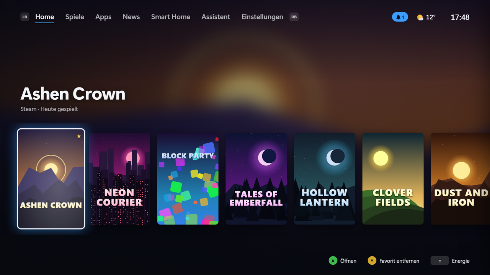
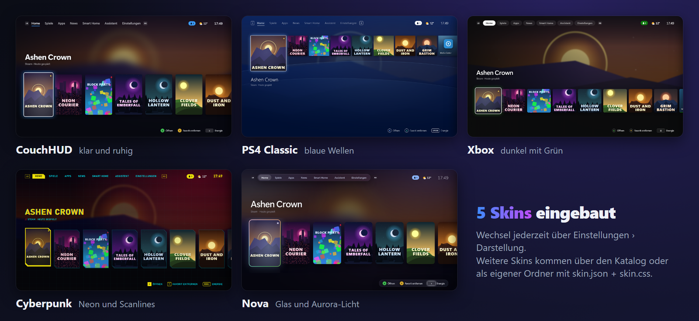

# CouchHUD – Guide

The complete guide: all features, settings, controls, configuration and architecture. Short overview and screenshots: [README](../README.md).

A controller-first, full-screen interface for the living-room PC on your TV. If you ask it to, it replaces the whole Windows shell (`explorer.exe`): after sign-in you land directly in CouchHUD, control everything with the controller, and leave it only when you deliberately switch to **PC mode**.

Independent of Steam Big Picture, Playnite and the like. Steam, Epic, GOG, Ubisoft and Xbox games are still detected automatically.



## Features

**Interface**
- **English and German**: the language follows the Windows display language by default and can be changed instantly under *Settings › Info › Language* (interface, messages, tray menu and setup). Texts and terms: [i18n.md](i18n.md).
- **Console UI** with the tabs Home, Games, Apps, News, Smart Home, Assistant and Settings. Smart Home appears once Home Assistant is connected, the Assistant once an AI provider is set up. Scales from 1080p to 4K.
- **Home shelf** with clear logos, large hero artwork and background trailers: when focus rests on a game for a moment, its Steam trailer starts silently in the background (can be turned off).
- **Colors from the artwork**: the background glows in the color of the focused cover.
- **Depth and motion**: parallax, slight tilt with a light reflection on the focused tile, boot screen, page transitions and a transition when a game starts ("Starting game …" with artwork). *Settings › Appearance › Reduce animations* removes depth effect, tilt and light reflection.
- **Skins**: CouchHUD, PS4 Classic, Xbox, Cyberpunk and Nova, with live preview. Custom skins are possible (see [Skins](#skins)).
- **HDR mode** (Off, Automatic, On): artwork and trailers at full HDR brightness, wide-gamut colors per skin (real neon for Cyberpunk), light reflection over the focused tile, boot flash. "On" switches Windows HDR on while CouchHUD runs.
- **UI sounds per skin** (synthesized live; custom skins can bring their own sound files) and optional subtle **background music** per skin, with separate volume sliders. Everything goes quiet as soon as a game or another full-screen app is in front.
- Controller vibration (can be turned off).
- **Screensaver** against OLED burn-in: artwork slideshow, moving clock, dimming or black, plus pixel shift and optionally TV off. Controller input also counts as activity for Windows.

**Library**
- Steam (all library folders), Epic, GOG (with and without Galaxy), Ubisoft Connect and Xbox/Game Pass are detected automatically, plus custom entries. The EA app and Battle.net start along as game clients, but their games only appear through watched game folders or custom entries.
- **Watch game folders**: everything in e.g. `D:\Games` lands in the library automatically, including games installed later. A search finds typical game folders on all drives.
- **Add**: on the Games and Apps pages the last tile is **+ Add** (also in the filter menu, X). On the Apps page CouchHUD first offers the **list of installed programs** like the Start menu, including Store apps such as Claude (LB/RB jump letter by letter, X searches; "Other …" at the end picks a file). Existing entries are marked. Store apps are launched through Windows itself (`shell:AppsFolder`); since no program folder is known, CouchHUD does not show them as "running". Adding needs the code while the couch is locked.
- **Launch parameters and working folder** (expert mode, custom entries with an EXE only): in the entry's edit dialog. Parameters are passed to the program individually, without a shell; the working folder must exist. The assistant and MCP cannot change them (only when creating via `add_entry`, with confirmation on the TV). Example "Claude Code": program `C:\Users\<name>\.local\bin\claude.exe`, parameters `--continue`, working folder `D:\couchhud` (or `wt.exe` with `-d D:\couchhud claude --continue` for Windows Terminal). Terminals, shells and interpreters (`claude`, `python`, `node`, `bash` …) are never games, only apps; on a locked couch they need the code.
- **Scan a folder**: CouchHUD suggests the matching EXEs and ignores installers, crash reporters and redistributables. You can rename entries, hide them, or classify them as game or app.
- **Search, sort, filter** (X in Games and Apps): via on-screen keyboard or phone; by name, last used, play time or store; favorites only.
- **Artwork** from SteamGridDB (cover, hero, clear logo; with your own key) and from the Steam store, also for non-Steam games. Local sources come first (Steam's `librarycache`, the Epic launcher's catalog cache, package logos of Xbox games, Ubisoft cache, icons of the program files), only then the Steam CDN and SteamGridDB; if everything is missing, CouchHUD draws a banner itself. **Every image is downloaded only once and then lives in the local artwork cache** (`%LOCALAPPDATA%\CouchHud\artwork`, at most about 750 MB, images of current entries are kept). The interface never loads artwork from the internet itself. In expert mode online artwork can be switched off and the cache cleared.
- **Change artwork**: on the detail page "Change artwork" shows all matches from SteamGridDB (with key) and the Steam CDN for cover, banner and logo. Choose with the controller, A applies, "Automatic" resets, "Own image" takes a file from the PC. The choice applies per entry and survives every scan.
- **Collections**: your own lists like "Couch co-op" or "Kids". Y on a tile in Games and Apps opens the menu with "Collections …" (the detail page has a "Collections" action; Y stays favorite there). X in Games and Apps shows a collection as a filter and manages it (create, rename, delete, name via on-screen keyboard). "Pin to Home" puts a tile in the row on Home.
- **Detail page** per game: description, screenshots, developer, genres (from the Steam store, in the interface language), play time, last played, install location, size, uninstall.
- **Running game and play time**: CouchHUD recognizes the running game (Steam AppID or processes in the install folder) and counts play time per game.
- **Back up save games**: locations, size and last change from the community database [Ludusavi manifest](https://github.com/mtkennerly/ludusavi-manifest) (PCGamingWiki, matched by Steam ID or name). On the detail page *Save games* › *Back up now* (dated ZIP under `%APPDATA%\CouchHud\Backups\<game>`, folder and count in settings) and *Restore* (the current state is backed up automatically first). A backup is offered before uninstalling. Backups with errors are marked incomplete and never deleted automatically, safety backups before a restore rotate separately (last 3), and if writing back fails the old state is restored automatically. While the game runs (even if it was started outside CouchHUD) both are blocked. Registry saves are shown but not yet backed up. The database (~18 MB) is downloaded from GitHub at most once a week.

**Controls**
- **Guide button like on a console**: the Guide button is polled globally via XInput and works even while a game runs. Tapping it in a game brings CouchHUD to the front, the running game is the first tile on Home and keeps running (frozen if you like). Holding it always brings you back from a game or PC mode. What a tap does is set under *Settings › Controller › Guide button in game* (*Open CouchHUD*, *Open Game Bar*, *Hold Guide only*). Two controller slots that mirror each other (virtual pads from Steam Input or DS4Windows) count only once.
- **Guide menu**: back to game, quit game (force on hangs), volume, per-app volume, audio output, CPU/GPU/RAM load, weather, controller battery, notifications, Bluetooth, captures, running programs, plugin actions, power-off timer, power.
- **Browser** for the TV: websites with the controller, stick as mouse pointer, large zoom, bookmarks, address via on-screen keyboard or phone. Its own profile without access to CouchHUD. The browser is part of the CouchHUD window (no separate window) with a slim bar on top: back, forward, reload, address (tap opens the on-screen keyboard), zoom, home, close. The bar fades out after a few seconds, the View button brings it back; B goes back in history and closes at the start, LB/RB zoom, Guide leads to CouchHUD, videos play full screen. **All links in CouchHUD open here** (news, plugins, website entries), never in the Windows default browser; the couch-lock rules apply (when locked, CouchHUD asks for the code), and only http and https are opened. After closing you are back where you came from (e.g. in the article). **Exception, DRM streaming:** Netflix, Disney+, Prime Video & co. do not play in the built-in browser (WebView2 ships without Widevine); for these website entries there is "Open in Edge" (the entry's edit menu), set from the start for known services. Only this uses the "Open Edge full screen" setting. Known limitation: Google sign-ins are blocked by Google in embedded browsers.
- **On-screen keyboard** (QWERTY) and **file browser** by controller.
- **Mouse**: when you move it, a large cartoon mouse appears as the pointer (with a wagging tail) and disappears again after a short while. Controller focus stays in charge. For logins and dialogs the controller itself can become the mouse.
- **Phone as keyboard and remote**: scan the QR code on the TV, then type, dictate or paste on the phone and operate with the D-pad and buttons. The Wi-Fi connection is unencrypted, so the phone never types into password and key fields: CouchHUD's own on-screen keyboard refuses it for secret fields, and before typing into a foreign window (launcher login) CouchHUD checks the field with Windows (password field or field name like "password", "PIN", "key") and rejects it. Such input belongs on the TV. To be honest: Windows cannot see into every field. Where the field stays unknown and the window belongs to a launcher or browser (Steam, Epic, Chrome, Edge, also CouchHUD's own browser), the phone does not type at all but asks for input on the TV; for games and other programs with no information, typing stays allowed. The check happens shortly before typing, only one check at a time, and only if the same window is still in front. The connection only accepts devices from your own network (private and link-local addresses, never from the internet; addresses from 100.64.0.0/10, i.e. Tailscale and other CGNAT networks, are deliberately rejected); paired phones expire after 180 days without use and can be unpaired individually. The firewall rule applies only to the port in use and the local subnet and disappears when phone connection and MCP on the network are off.
- **Notifications** like on PlayStation: cards at the top right, list in the Guide menu. Optionally also WhatsApp, Discord & co. from Windows.

**System**
- **Two integration levels**: *Light* (default, the beginner mode) is a normal full-screen app, optionally with the taskbar hidden; Steam & co. stay as usual and CouchHUD does not touch clients (no starting, no closing, no moving windows away, no Steam settings). *Full* unlocks shell replacement, couch lock, auto sign-in, services and autostart takeover; Steam & co. start along, run quietly in the background and are closed when you quit. Going back to Light undoes these changes. The button *Settings › Console › Set up CouchHUD as a console* does all of this in one guided run (see [Settings](#settings)). Under *What CouchHUD changes in Windows* (transparency) every change is listed with location, admin need (🛡), state and way back.
- **Runs without administrator rights.** What needs admin (lock policies, pausing gaming services, auto sign-in, Windows Update, firewall, updates) is done by the Windows service **CouchHud.Service** with a fixed command list, without a UAC prompt in daily use. CouchHud.exe never starts with administrator rights. What parents or an administrator must confirm, CouchHUD asks via parent code or, as a fallback, via Windows User Account Control (see [CouchHUD service, codes and approvals](#couchhud-service-codes-and-approvals)).
- **Standard account for kids**: CouchHUD needs no administrator token day to day. The service always works only for the account that calls it, so even a normal standard account can set the lock policies without an administrator dialog; they can only be lifted with approval (code or Windows sign-in) or as administrator. If kids use the controller, it is best to set CouchHUD up for such a standard account (details and limits under *Runs without administrator rights* and *Couch and PC mode profiles*).
- **Shell replacement** per user (`HKCU\...\Winlogon\Shell`). As the shell, CouchHUD runs **without Windows Explorer**; the desktop (Explorer) comes only in PC mode or after emergency mode. CouchHUD starts the autostart programs itself (Run keys and Startup folder, disabled entries stay off).
- **PC mode**: starts the normal desktop. Back with a held Guide button, via the tray icon or by restarting CouchHUD.
- **CouchHUD stays in front** (full integration only, can be turned off): the foreground guard minimizes windows of game clients (Steam incl. Big Picture, Epic, EA, Ubisoft, GOG, Battle.net, Xbox app, Playnite) and known update pop-ups that push in front of CouchHUD, and the Windows Game Bar yields the Guide button. Steam also holds back: it does not start in Big Picture mode, the Guide button does not bring Steam forward, no Big Picture overlay on controller and no pop-up when a controller connects (Steam's own settings, nothing on the account; the Steam overlay and Steam's Guide shortcut in games stay). Steam writes its files itself, so CouchHUD only changes them when Steam is not running: if it runs, CouchHUD closes it cleanly only to apply, and only in a quiet moment (no game, no Steam window in front, no download, no sign-in), writes and restarts it quietly; otherwise it waits. Resetting never restarts Steam, it happens as soon as Steam is not running. Exceptions: a game is running, controller-as-mouse (e.g. client login), browser, PC mode and anything CouchHUD started itself. In PC mode, in Light mode and on quit everything is back as before (for Steam only what still comes from CouchHUD: if Steam or you changed something in the meantime, it stays).
- **Game clients in the background** (full integration only; in Light mode CouchHUD does not intervene): Steam, Epic, GOG Galaxy, Ubisoft Connect, EA app and Battle.net each have a mode (*Settings › Game clients*): *Keep ready* (default: starts quietly with the couch mode so updates and downloads run right away), *On demand* (starts with the first game or action that needs it) or *Off*. When quitting CouchHUD and when switching to PC mode, CouchHUD closes the Steam it started itself (with `-shutdown`, never by force); Steam that was already running or that you (re)started yourself is left alone. If Steam is downloading or a game runs, it stays open (with a note in PC mode). The other clients are left open for now: they have no download detection and no proof that closing cancels nothing. Steam's settings for the couch are set before its own start and reset after its own end; only a Steam that ran before CouchHUD is briefly restarted for this in a quiet moment. For sign-in CouchHUD brings the client window to the front, the controller becomes the mouse and the paired phone types into the user-name field if Windows reports it as a normal input field (otherwise it asks for input on the TV); the password comes via the on-screen keyboard on the TV (Steam also offers QR login via the Steam app there).
- **Couch and PC mode profiles**: for each autostart program, set whether it starts with CouchHUD or only in PC mode (with a recommendation: game tools stay, Office and sync wait). Windows services like Search or Print Spooler pause while gaming and come back in PC mode, without a UAC prompt. The CouchHUD service does this (CouchHud.Service, LocalSystem, in `C:\Program Files\CouchHud\service`): a fixed list of operations with checked parameters, never "start this program" or "open this path", and always only for the caller's own account. Only services on its own fixed list are paused, only those it stopped itself are resumed. The service replaces the scheduled tasks of earlier versions; only the fallback task "Autologon off" stays for recovery. If the service is missing, the couch lock stays closed (fail-closed); "Repair service" sets it up again (see [Emergency exit](#emergency-exit)).
- **Audio**: volume, mute, **per-app volume** (running game first, in the Guide menu), switch output device (TV, headphones, soundbar). When a headset is connected, output switches automatically.
- **Display**: resolution, refresh rate and HDR, with a "Keep this setting?" countdown like on consoles. Plus a **night mode** (warmer picture, also in games, optionally automatic in the evening).
- **Game profiles** like on the Steam Deck: per game resolution/Hz, HDR, audio output and night mode. Applies only while the game runs.
- **Downloads**: running Steam installs and updates with progress.
- **Bluetooth**: pair and remove headphones, controllers and speakers.
- **Wi-Fi**: search networks, connect with a password via the on-screen keyboard, disconnect, status with IP (Settings › Network). Needs Windows location access for the search.
- **Power**: standby, restart, restart directly into PC mode (once), shut down, power-off timer (sends the PC to standby after a while).
- **Task manager** for the TV: running programs with memory use, end hung ones.
- **Updates**: Windows Update (search and install with one confirmation) and app updates via winget, individually or all. Searching happens automatically in the background, never during a game.
- **CouchHUD updates itself**: every 12 hours (and via "Check for updates") it asks GitHub for a new version, reports it in notifications and shows version and changes in the *CouchHUD* section of the Updates page. "Install" downloads the setup (only from github.com over https), checks the **signature of the checksum file** (ECDSA, same key as the catalog) and the SHA-256 of the setup, and hands it to the CouchHUD service. The service checks signature, checksum and version (only newer, no downgrade) again itself and installs silently, without a UAC prompt; afterwards CouchHUD restarts by itself, also as shell. Without a valid signature nothing is installed, and not during a game either. Turn off the check: Settings › Updates › *Automatically check for CouchHUD updates* (`"selfUpdateCheck": false`).

**Protection and emergency exit**
- **Couch lock**: leaving CouchHUD (PC mode, quit, client windows) needs a controller code (six to eight buttons) or the Windows sign-in (Windows Hello, PIN, password). After five wrong attempts the wait grows (30 s, 60 s, 120 s … up to 30 minutes, also across a restart). A guard process locks Windows if CouchHUD is closed or crashes; Task Manager is blocked in couch mode. Ideal together with the automatic Windows sign-in CouchHUD sets up (the password is entered once, checked and stored encrypted by Windows; CouchHUD never stores it). With the lock closed, CouchHUD only starts games (apps and web pages need unlocking; an app started that way stays *approved until return to the HUD*, which CouchHUD shows), holds game clients back after the start phase (even if CouchHUD started them itself), minimizes clearly recognized non-games (settings, Explorer, consoles, browsers outside the game), closes file and print dialogs and sets reversible Windows policies (no Control Panel, no Run, no command prompt, accessibility shortcuts off; cmd, PowerShell, regedit, mmc and wt cannot be started through the Windows shell while locked). Unlocking is valid only briefly and **now also ends at every game start and every return to the HUD, not only with parental controls**; in the browser it is extended on use and the browser closes as soon as it is locked again. Windows sign-in as the lock requires an account with a password. The controller code also works without a password, CouchHUD then warns clearly; automatic sign-in is dropped without a password (Windows signs in anyway). **To be honest: the lock is only as strong as the account's Windows password** (see [Disclaimer](DISCLAIMER.md)). It keeps kids and guests at the controller out, not tech-savvy people with a keyboard, boot media or a removed drive. **Device encryption or BitLocker is recommended** (the one-button setup points this out but does not switch it on itself).
- **Parental controls** (*Settings › Parental controls*): play-time rules for kids at the controller.
  - *Parent code*: this is the couch-lock code or the Windows sign-in. **Parental controls exist only on an account with a password**, even with a controller code (otherwise one could simply walk past the lock screen and the recovery). The code applies to a single action **on a single entry** with its own prompt: it does not open the couch lock, and every change (setting, extending, releasing a blocked game, changing code or lock, re-rating a game/app, adding a game or a game folder) asks again. Parent code and couch code count wrong attempts separately. With Windows sign-in, CouchHUD shows the pending action after unlocking and waits for A; the request is valid for three minutes and only for a lock that CouchHUD itself triggered.
  - *Rules*: daily limit (Mon–Fri and weekend separately), play-time window (also past midnight, e.g. 10 pm to 1 am), per-game limit, age limit (block from ESRB/USK 6/12/16/18 according to the Steam rating; games without an age rating then start only with the parent code, can be turned off), individual games or apps only with the parent code, and "Count apps too".
  - *Counting*: the running time of games CouchHUD sees running is counted, including those started without CouchHUD or already running at start (library entries with a Steam ID or program folder), not while paused. Entries of the same game share limit and lock. Entries without a recognizable process (web pages, Store apps without a folder) cannot be measured and therefore start only with the parent code (except apps when "Count apps too" is off). While one game runs, no second one starts, and game clients like Steam stay minimized (their file dialogs would be a way out of the couch).
  - *Course of events*: 15 and 5 minutes before, an overlay appears over the game with the real remaining time (it may be missing in exclusive full screen, then the notification in CouchHUD remains). At expiry the game is paused and CouchHUD comes to the front with *Time is up*: *Save game and quit* or *Extend with parent code* (+15/+30/+60 minutes, applies to daily limit, window and game; for a window past midnight, an extension before midnight extends only this window, not the next day's limit). Without a decision CouchHUD closes the game after 60 seconds (close window, after 2 minutes terminate). If the parents extend while the game is already being closed, the closing is cancelled. If it cannot be ended (elevated process), CouchHUD locks Windows (only while the time is really over) and keeps asking. Outside the window or after the daily limit nothing starts, with a note. The remaining time is shown at the top in the header and in the Guide menu.
  - *Tamper protection*: time is stored per day in `playtime.json` (saved every 30 seconds, with HMAC against editing; a changed or deleted file counts the day as used up until the parents reset the counter). Counting follows the runtime clock and the time zone saved at power-on, not the system clock: changing the clock or time zone yields no play time, not even across a restart. A system clock moved ahead is accepted only after confirmation by the HTTPS date from www.microsoft.com or via parent code, also at start (offline it stays at the last saved day). Unlocking, parent approval and the wait after wrong attempts also follow the runtime clock. `playtime.json` is written through and replaced with a backup copy.
  - *Prerequisites and limits*: works only as shell with couch lock; otherwise (Light mode, lock off) there are only hints, and in PC mode it rests. The protection works against kids at the controller, not against tech-savvy people: whoever has file access to the user folder can change the settings, and games without a recognizable program folder (URL start only) are not counted but need the parent code. If a game that was not started through CouchHUD runs (Steam, launcher), CouchHUD checks it afterwards against the block list, age limit and time and treats a violation like expired time. Processes a game (or its launcher) starts count too.
- **Emergency mode (panic button)**: hold Ctrl + Shift or LB + RB + View for about 1.5 seconds at start (or three unclean exits in a row within a few hours). This works in two steps because anyone at the controller could trigger it: first CouchHUD only locks Windows and waits. **Only after Windows sign-in with the account's password** does it remove the shell entry and (CouchHUD-created) auto sign-in, and the normal desktop comes. Anyone who chooses "Restart" on the lock screen instead lands in the couch again. Without a couch lock the first step is skipped. If Windows cannot be locked for the first step even after several tries, CouchHUD changes nothing, counts the unclean exits again (the next start tries again), shows a message and starts the couch as usual behind its lock: a kid at the controller should not reach the desktop without a password. If an auto sign-in remains (e.g. set up via netplwiz) and CouchHUD is not the shell, a Run entry of the account locks Windows right after an **automatic** sign-in (recognized by the session being signed in within a few seconds); whoever signs in by hand is not locked again. The entry follows every change of shell, auto sign-in and couch lock and disappears on uninstall.
- **Robust**: if the UI crashes, it is rebuilt. If CouchHUD does not start at all, it brings the desktop back. Logs are in `%LOCALAPPDATA%\CouchHud\logs`.

**Extras**
- **Weather** in the header (Open-Meteo, no account), with forecast in the Guide menu.
- **Captures**: screenshot and "Save clip" straight from the Guide menu (via the Game Bar), gallery for screenshots and clips from Game Bar, Steam and NVIDIA.
- **News**: RSS/Atom reader with large type for the TV. WinFuture and Caschys Blog are preconfigured, add more feeds in settings.
- **Home Assistant**: scenes, lights, switches, media players and sensors as live cards. You can pin individual entries to the Guide menu.
- **CaseHUD**: control the LCDs in fans and pumps from the sofa (Settings › CaseHUD). CouchHUD installs [CaseHUD](https://github.com/kewe87/CaseHUD) on request, starts it and controls it through its local API: displays as tiles with live preview, design per display from a grid (matching the resolution, filtered by set and theme), brightness, rotation, mode, one set for all displays, scenes, scene switching, community designs, AWTRIX, "Open on PC" for the design editor. In the Guide menu: displays off/on and next scene. Installed and updated only from signed releases; if downloads are currently unreachable it says "Downloads currently unavailable" and *Check again* asks by hand. More: [CASEHUD.md](CASEHUD.md)
- **AI assistant** with your own API key (Anthropic or OpenAI): "What should I play today?", "Start the game I played last", "Turn off the light", "Switch to the Cyberpunk skin". You must confirm every change on the TV with A.
- **MCP server** (optional, off by default): other AI programs, e.g. on a laptop, control CouchHUD over the Model Context Protocol, with the same tools as the assistant.
- **Plugins and skins** from the community, installable directly as `.zip` or from the **catalog**, with update notice. Included: **Wand** (formerly WeMod) for cheats and mods. The default catalog [`kewe87/CouchHUD-Catalog`](https://github.com/kewe87/CouchHUD-Catalog) contains real entries (Wand, Synthwave) with a signed index and checksums.

## Settings

Everything can be configured in **Settings** by controller. You do not have to touch `config.json`. Settings have two levels:

- **Simple** (default): only the everyday things (library, appearance, display, audio, controller, phone, news, weather & smart home, notifications, updates, power, parental controls, info) and at the very top the **Console** button: *Set up CouchHUD as a console* turns the PC into a console in one run (full integration, autostart profiles, paused services, Guide button for CouchHUD, couch lock with controller code, automatic sign-in, shell). Beforehand an overview shows what will happen, afterwards it shows what worked and what was skipped (with reason). Running it again repairs. *Back to normal Windows* undoes everything. At the end CouchHUD offers a restart to try it out.
- **Expert mode** (*Settings › Expert mode*): additionally shows all fine settings, in the categories as a separate "Expert" section (e.g. refresh rate, HDR effects, sound set, Guide hold time) and as separate categories below the divider (Windows integration, Autostart & services, Network with the firewall rule, AI & MCP, Plugins & skins). Each setting exists in only one place. Actions like Bluetooth devices, view notifications, captures, running programs and power shortcuts live in the Guide menu.

## Controls

| Controller | Keyboard | Action |
|---|---|---|
| D-pad / left stick | Arrow keys | Navigation |
| A | Enter / Space | Open / select |
| B | Esc / Backspace | Back |
| X | X | Context action (e.g. refresh news, search for updates; in Games and Apps: search, sort, filter, collections) |
| Y | F / Y | On Home and the detail page: favorite on/off. In Games and Apps: tile menu (favorite, collections …, details). In the Smart Home tab: pin to the Guide menu |
| LB / RB | Q / E or Page Up / Page Down | Switch tab |
| Start (≡) | M | Power menu |
| Guide button (middle button of the pad) | Home | Guide menu. Tapping it in a game brings CouchHUD to the front (configurable). **Holding** always brings you back from a game or PC mode |
| Back + Start | – | Alternative to the Guide button |
| LB + RB + View at start ~1.5 s | Ctrl + Shift at start ~1.5 s | Emergency mode: normal desktop instead of CouchHUD afterwards |

On-screen keyboard: A types, X deletes, Y space, LB shift, RB special characters, Start (≡) done, B cancel. With a real keyboard you type directly; Enter ends the input, Esc cancels. If you drive the keyboard with arrows (remote), Enter presses the highlighted key and **Ctrl + Enter** ends the input.

## Setup

Requirements: Windows 10/11 (the WebView2 runtime ships with Windows 11), an XInput controller (Xbox pads, or PlayStation pads via Steam Input/DS4Windows).

**Setup (recommended):** under [Releases](https://github.com/kewe87/CouchHUD/releases), or for every build under *Actions → build → Artifacts → CouchHud-Setup*, there is `CouchHud-Setup-<version>.exe`. The setup (English and German) installs to `C:\Program Files\CouchHud` (the protected folder the admin features require), brings the WebView2 runtime if needed, and creates a Start menu entry, optionally a desktop icon and autostart. It changes nothing about Windows sign-in: CouchHUD starts at the *Light* level. Uninstalling resets everything CouchHUD changed in Windows and asks whether to delete the settings. The setup is not (yet) Authenticode-signed, so SmartScreen warns on first start ("More info › Run anyway"). CouchHUD's own update check is signed independently of that (see self-update).

**First start:** a setup assistant asks a few questions, one per screen: language, confirm disclaimer and privacy, *Light* or *Full*, skin with live preview and mouse pointer, sound, and for *Full* the game clients (*Keep ready* or *On demand*). The *Full* choice is only noted: only *Let's go* in the summary starts the console setup from *Settings › Console* (with administrator confirmation, controller code and restart offer); if it stays incomplete, CouchHUD says so briefly afterwards. During the assistant and the first notice no notification cards appear, only the bell counts. Every step can be skipped with Y, ≡ ends the assistant; everything stays changeable in settings, the assistant itself sets nothing that does not exist there. Start it again: *Settings › Info › Restart setup assistant* (with an active couch lock only after the code). Older installations are offered it once, not forced.

**Without the setup:** unpack the ZIP `CouchHud-win-x64` from the artifacts to `C:\Program Files\CouchHud` and start `CouchHud.exe`. The build brings .NET with it (self-contained), it only needs the WebView2 runtime, which ships with Windows 11.

**Creating a release** (for maintainers, details in [CONTRIBUTING.md](../CONTRIBUTING.md#release)):

1. Set the version in `Directory.Build.props`, push the tag: `git tag v0.4.0 && git push origin v0.4.0`. CI builds the setup with that version and attaches `CouchHud-Setup-0.4.0.exe` and `CouchHud-Setup-0.4.0.exe.sha256` to a GitHub release. A tag build aborts if the tag does not match the version in `Directory.Build.props`.
2. Verify and sign locally: `.\scripts\sign-release.ps1 -Tag v0.4.0` (PowerShell 7, GitHub CLI `gh` signed in). The script checks commit, version and hash of the setup and CI's build attestation, and only then signs the `.sha256` (context `couchhud-release-v1`) with the private key from the user profile; afterwards it uploads `.sha256.sig`.

Only with step 2 do installed CouchHUDs offer the update. The release notes (generated from pull requests, editable after tagging) appear shortened on the TV.

### Build from source

(.NET 10 SDK, for the setup additionally [Inno Setup 6](https://jrsoftware.org/isinfo.php)):

```powershell
dotnet build CouchHud.slnx
dotnet test CouchHud.slnx
dotnet run --project src/CouchHud.Shell -- --dev   # windowed mode with DevTools
dotnet publish src/CouchHud.Shell -c Release -r win-x64 --self-contained true -o publish
iscc /DAppVersion=0.4.0 installer\CouchHud.iss    # optional: setup into installer\output
```

For the console experience afterwards choose "Set up CouchHUD as a console" under *Settings › Console*. On the next start CouchHUD appears instead of the desktop. If you prefer to switch things on individually, enable expert mode and find everything under *Windows integration*.

### Important Windows settings

- **Xbox Game Bar and the Guide button**: by default the Game Bar grabs the Guide button. With "Set up CouchHUD as a console" (or *Settings › Controller › Guide button in game › Open CouchHUD*) the Game Bar yields the button as long as "CouchHUD stays in front" is on (CouchHUD saves the old value and restores it in PC mode, in Light mode and on quit). By hand: under *Settings → Gaming → Xbox Game Bar* turn off "Open Xbox Game Bar using this button on a controller". Alternatively Back + Start works.
- **Auto sign-in**: for a real console feel via the console button (or in expert mode under *Windows integration › Set up automatic sign-in*). You enter your Windows password once on the on-screen keyboard on the TV (never via the phone), CouchHUD checks it with Windows and has Windows store it encrypted as an LSA secret (like Sysinternals Autologon). CouchHUD does not store the password, neither in the configuration nor in the log. Whoever switches on the PC lands in CouchHUD, the couch lock protects leaving: please set both up together, and protect the drive with BitLocker/device encryption. On uninstall the sign-in is removed again if CouchHUD set it up. `netplwiz` stays as an alternative for experts (the phone does not type there, the password comes via the on-screen keyboard).

### Emergency exit

If something goes wrong and you only get a black screen:
1. Hold **Ctrl + Shift** (or **LB + RB + View**) for about 1.5 seconds at start: Windows locks, and **after signing in with the Windows password** the normal desktop comes. The owner knows the password (it is the account password, not the couch code). An account without a password needs only a click on the lock screen, which is why parental controls exist only with a password.
2. Otherwise: `Ctrl + Alt + Del` → **Task Manager** → *Run new task* → `explorer.exe`
3. Remove the shell entry: `reg delete "HKCU\Software\Microsoft\Windows NT\CurrentVersion\Winlogon" /v Shell /f`

**Repair service**: if the CouchHUD service no longer runs, "Repair service" sets it up again with the fixed, hardened configuration (Windows programs only: `sc.exe`, `icacls.exe`, `reg.exe`). Before confirming in the UAC prompt open *Show more details*: the program must be `C:\Windows\System32\cmd.exe`, the command line `/d /c ""C:\Program Files\CouchHud\repair-service.cmd""`. If anything else is shown, cancel.

### CouchHUD service, codes and approvals

Everything that needs administrator rights is done by the **CouchHUD service** (`CouchHud.Service`, runs as SYSTEM, lives in `C:\Program Files\CouchHud\service`). CouchHUD itself never runs with administrator rights and talks to the service only over a local pipe; before every contact it checks that the pipe really belongs to the service. The service always acts only for the account that calls it (from that account's Windows sign-in, never from the request), and only with a fixed list of actions.

- **Codes and lock mode live in the service.** The service checks the couch code and (with parental controls) the parent code itself, with its own counter for wrong attempts per code: after five wrong codes every further attempt waits, first 30 seconds, then twice as long each time, at most 15 minutes. The counter survives restarts of the service and the PC. The service also knows the account's lock mode (off, Windows sign-in, code): switching on and tightening is possible any time, weakening or switching off only with proof of the previous mode (code or unlock) or with parents or an administrator. The first code is free only while no lock is on, and survives switching on a lock only if it is set along with it (CouchHUD asks for the code when switching on the code lock); code mode without a code stays closed. Switching off also removes the code from the service, as does switching to Windows sign-in (where only unlocking counts); "Parental controls off" removes the parent code. The configuration in the user folder no longer holds a code hash. The service's data (`service\data`) may only be read by SYSTEM and administrators. *Settings › Console* shows which codes the service holds for this account.
- **Approvals.** A correct couch code gives an approval for 2 minutes (the unlock window), bound to the account, the Windows sign-in and the Windows session. It ends earlier if the session is locked, disconnected or signed out, and does not count while the session is locked. With it the service releases the lock policies, opens the firewall rule or keeps the session during an update. In lock mode "Windows sign-in", unlocking your own session, which the service saw itself, counts instead; never in code mode, never for an account without a password and never a mere sign-in.
- **What parents or an administrator must confirm**: automatic sign-in, changing or removing the parent code, changing or removing the couch code next to a parent code, weakening the lock while a parent code exists, opening a lock without a code. CouchHUD asks for the **parent code** for this; the approval then applies only to exactly this action, once, for 30 seconds. If that is not possible (no parent code, too many wrong attempts), an **administrator** of this PC confirms via Windows **User Account Control (UAC)**: CouchHUD first says what is being confirmed; then Windows' own UAC prompt on the secure desktop shows the program `sc.exe` (service control) with `control CouchHud <number>`. The administrator's password is typed only into that Windows prompt, CouchHUD never sees it. The approval goes to the account at the couch, not the administrator, only for the named action, once; the request expires after 60 seconds. If parents or an administrator set a single code anew, the other one disappears (a planted code does not survive that); with parental controls CouchHUD always sets both.
- **Parent code.** With parental controls the parent code is the couch code. The service adopts it only together with a new code (both in one step) or with confirmation by parents or an administrator; the couch code alone never makes a parent code. When switching on parental controls at the unlocked couch, CouchHUD therefore asks for the code right away and stores it as couch and parent code; an administrator confirms this once via UAC. If parental controls are switched on at the locked couch, CouchHUD deliberately sets no code (the locked couch accepts no new code); set the code again at the unlocked couch.
- **Takeover on update.** On first contact the service adopts the code hash and lock mode from the configuration, once per account. **Honest limit:** at that moment the service cannot know whether a user program changed the configuration beforehand. It accepts only a hash in CouchHUD's format, never over a code it already knows, and a mode never weaker than the one it already knows; afterwards it is the authoritative source. If the service knows codes that the settings do not, the setup assistant points this out.

**Honest limits of the service**
- An administrator's password does not pass through CouchHUD: Windows' UAC prompt takes it. **Honest limit:** the prompt shows only `sc.exe control CouchHud <number>`, not the action. Only one request is open per session; but a program already running as your account could place its own before CouchHUD (another action, same account), and a confirmation binds the action, not its details. So confirm only if you just triggered the action yourself and CouchHUD has just announced it. The password for automatic sign-in and the code buttons, on the other hand, arrive as .NET strings that cannot be wiped and stay in memory until garbage collection. None of it is logged.
- The **Windows sign-in** opens the way even without a running service (emergency exit above): whoever knows the account's Windows password reaches the desktop. A sign-in does not yield an approval in the service, though: restrictions a crashed run left behind are released by the service afterwards only with a code, unlocking in Windows mode or an administrator (UAC).
- A program already running as your account can read along with the controller and fetch approvals from CouchHUD's memory. The service raises the hurdle against kids at the controller and against the UAC boundary, not against malware in your own account.
- The "account without password" check shows up once per account and service start as a failed sign-in in the security log.
- **"Repair service"** asks an administrator via UAC and starts only `cmd.exe` with the fixed repair script from the program folder (see above, check the details in the UAC prompt).

## Skins

Switch under *Settings › Appearance › Skin*, with live preview while browsing (B cancels).



A skin is a stylesheet plus optional button glyphs and sounds. Custom skins go to `%APPDATA%\CouchHud\skins\<name>\`:

```
skin.json  { "name": "My skin", "description": "…", "glyphs": { "A": "✕", "LB": "L1" } }
skin.css   :root[data-skin="user:<name>"] { --accent: hotpink; --tile-radius: 0; … }
```

The most important variables: `--bg`, `--fg`, `--muted`, `--accent`, `--accent-glow`, `--panel`, `--font`, `--tile-radius`, `--shelf-tile`, `--focus-scale`. For everything else you can override the selectors from `ui/styles.css`, see the built-in skins in `ui/skins/`. Full guide: [SKINS.md](SKINS.md).

## Configuration

`%APPDATA%\CouchHud\config.json` is created on first start. Everything in it can also be changed in settings, the file is just the storage. Secrets (API keys, tokens) are stored there encrypted with DPAPI. **If the file is damaged or unreadable**, CouchHUD runs locked (Windows sign-in as couch lock, parental controls strict: no game starts) and writes nothing to the file until it is usable again. Unreadable (e.g. held by another program): CouchHUD retries every 15 seconds. Damaged: **the way out is to repair or delete `config.json`** (CouchHUD then starts with default values; lock and parental controls are off afterwards). Next to it lies a copy `config.json.<time>.bad` (identical content only once, at most five), which is only a copy: better edit or delete the real `config.json`. The few emergency fields (hint "shell removed", return to the couch) CouchHUD keeps in `config.json.recovery` during that time and merges after the repair. An excerpt:

```json
{
  "killExplorerOnReturn": false,
  "runStartupApps": true,
  "sounds": true,
  "audioMode": "ui",
  "musicVolume": 35,
  "guideTapInGame": true,
  "pauseGameInMenu": false,
  "screensaverMinutes": 5,
  "screensaverStyle": "art",
  "displayOffMinutes": 0,
  "pixelShift": true,
  "reduceMotion": false,
  "language": "en",
  "integrationMode": "light",
  "closeExplorerInLight": false,
  "browserZoom": 150,
  "couchLock": "off",
  "blockTaskManager": true,
  "returnHoldMs": 1000,
  "skin": "nova",
  "steamGridDbApiKey": "",
  "apps": [
    { "name": "YouTube", "type": "app", "url": "https://www.youtube.com/tv" },
    { "name": "Kodi", "type": "app", "path": "C:\\Program Files\\Kodi\\kodi.exe", "image": "C:\\Pictures\\kodi.png" },
    { "name": "Retro emulator", "type": "game", "path": "D:\\RetroArch\\retroarch.exe", "args": ["-f"] }
  ]
}
```

- `killExplorerOnReturn`: when switching back from PC mode, end `explorer.exe` (cleaner, but closes open Explorer windows).
- `runStartupApps`: run autostart entries at boot when CouchHUD is the shell.
- `language`: `auto`, `de` or `en`. (This fork defaults to `en`.)
- `steamGridDbApiKey`: optional, free key from [SteamGridDB](https://www.steamgriddb.com/profile/preferences/api) for covers of non-Steam games and apps. Without a key it searches the Steam store by name.
- `image`: cover as a local path or URL (portrait 2:3 for games, 16:9 for apps).

## AI assistant and MCP

Under *Settings › AI & MCP* (expert mode) you choose the provider (Anthropic or OpenAI), store your API key (encrypted with Windows DPAPI) and pick the model. Afterwards the **Assistant** tab appears.

The assistant works only through a fixed list of tools: search the library, read details, launch, favorites, edit and create entries, rescan the library, change settings and skin, weather, news, updates, Home Assistant, volume, audio output, power. It runs no shell commands and does not access files. It never sees API keys and tokens.

**MCP server**: switching it on creates a token. The address and token are shown in settings. Example for an MCP client with Streamable HTTP:

```json
{
  "mcpServers": {
    "couchhud": {
      "type": "http",
      "url": "http://192.168.178.42:8765/mcp",
      "headers": { "Authorization": "Bearer <token from the settings>" }
    }
  }
}
```

Without "Reachable from the network" the server listens only on `localhost`. For access from the LAN the CouchHUD service (with approval, without a UAC prompt) creates a firewall rule named **"CouchHUD Remote (CouchHUD)"** (allow only, inbound, TCP); it applies only to the ports in use (default 8765) and the local subnet. Windows' own rules are not touched, Windows block rules are only reported. The server accepts requests only from your own network (private and link-local addresses). Every change from outside and reading the Home Assistant states is shown by CouchHUD as a question on the TV (the answer comes only from the TV, never from the phone); plugin tools are always confirmed over MCP, with their arguments. With the couch locked, assistant and MCP offer only lookup and launching from the library.

## Plugins and skins

CouchHUD is meant to grow with the community. Both can be installed directly in the interface as a `.zip` (*Settings › Appearance › Install new skins*, or in expert mode *Plugins & skins*).

- **Plugins** (C#, SDK v2) bring game sources, custom pages, settings, entries in the Guide menu, tools for the AI assistant, and react to game start and end. CouchHUD renders plugin interfaces itself, so they fit every skin and work with the controller. Guide: [PLUGINS.md](PLUGINS.md)
- **Skins** (CSS) change colors, fonts, shapes and layout. Guide: [SKINS.md](SKINS.md)
- Included: **Wand** (formerly WeMod), cheats and mods via the Guide menu, optionally automatic with every game. Also the example for your own plugins.
- **Catalog**: *Plugins & skins › Catalog* lists plugins and skins from a JSON index on GitHub (default `kewe87/CouchHUD-Catalog`, more sources in `config.json`). The default catalog's index is signed, install and updates work with A, only over https and with a mandatory checksum (SHA-256); before plugins CouchHUD warns that they run with your rights. In the background (never in a game) CouchHUD looks for updates and reports them in notifications and on the Updates page. Format and security: [PLUGINS.md](PLUGINS.md#catalog)

How to contribute: [CONTRIBUTING.md](../CONTRIBUTING.md)

## Architecture

```
ui/                        Web UI (vanilla JS/CSS as ES modules, no build pipeline), runs in WebView2
  app.js                   Start, tabs, global keys
  core/                    Navigation, state, library, artwork, trailers, weather, i18n
  views/                   Home, grid, detail, news, smart home, assistant, updates, settings
  components/              Overlay menus, Guide menu, on-screen keyboard, file browser, mouse
  i18n/de, i18n/en         Interface texts (one file per area)
  skins/                   Built-in skins
  bridge.js / mock-api.js  Host bridge (chrome.webview) / mock data for the browser preview
src/CouchHud.Sdk/          Plugin API
src/CouchHud.Core/         Platform-neutral and tested: config, scanner (Steam/Epic/custom),
                           artwork, store info, play-time tracking, save games, parental controls,
                           file browser, EXE scan, weather, news, Home Assistant, winget parser,
                           AI assistant, MCP protocol, catalog and self-update, texts (Localization)
src/CouchHud.Shell/        WPF + WebView2 host
  Hud.cs                   Orchestration: Guide button, PC mode, tray, bridge API
  Input/XInputPoller.cs    XInput incl. Guide (XInputGetStateEx), vibration, battery
  Native/                  Win32 and Core Audio (COM)
  Services/                Shell registry, autostart, power, launcher, audio, updates, couch lock,
                           foreground guard, parental controls, assistant tools, MCP server (Kestrel)
  UiHost/                  JSON bridge to the UI, local files for artwork/skins
plugins/                   Bundled plugin (Wand)
installer/                 Inno Setup script
catalog/                   Example of a plugin catalog (index.json + signature)
scripts/                   check.sh, i18n-check, preview server, signing and VM scripts
tests/                     xUnit tests for Core
```

Everything with admin rights is done by the Windows service **CouchHud.Service** (`src/CouchHud.Service`, LocalSystem) over a named pipe with a fixed command list; the shell itself never needs admin. Protocol in `src/CouchHud.Service.Contracts`, admin code in `src/CouchHud.Privileged`, client in `src/CouchHud.ServiceClient`.

## UI development without Windows

```bash
node scripts/preview-server.js   # http://localhost:5173, complete UI with mock data in the browser (?lang=en for English)
```

More on this (screenshots via `ui-shot.mjs`, VM tests) in [CONTRIBUTING.md](../CONTRIBUTING.md).

## Roadmap

The full plan with order, plugin SDK and the hardware integrations (FanControl, SignalRGB, CaseHUD) is in [ROADMAP.md](ROADMAP.md).

## Disclaimer and privacy

CouchHUD is provided without warranty, use is at your own risk: [Disclaimer](DISCLAIMER.md). No telemetry, no account. Which data lives locally and which services CouchHUD contacts and when is in the [privacy notice](PRIVACY.md). You confirm both on first start.

## License

Copyright © 2026 **kewe87**

This program is free software under the **GNU General Public License v3.0** ([LICENSE](../LICENSE)). You may use, modify and share it – forks and derivatives must also stay open under the GPL-3.0 and keep the copyright notice "kewe87".
